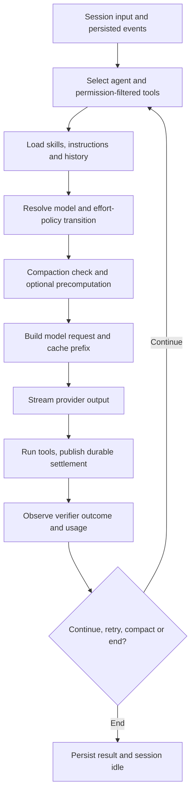

# What the strongest coding harnesses do—and what the evidence means for FiFeCode

**Research date:** November 2, 2026 (America/Los_Angeles)  
**Scope:** Research and evidence-based diagnosis, not implementation planning  
**Target:** [`DeputyFifeofMayberry/opencode_fife`](https://github.com/DeputyFifeofMayberry/opencode_fife) at [`07bae7483b6a7983bae2008407683097235e06c5`](https://github.com/DeputyFifeofMayberry/opencode_fife/commit/07bae7483b6a7983bae2008407683097235e06c5)  
**Companion documents:** [Fork gap analysis](opencode-fife-harness-gap-analysis-2026-11-02.md) · [Evidence ledger](harness-engineering-evidence-ledger-2026-11-02.md)

## 1. Scope, baseline and confidence

This research examined the **published** FiFeCode fork, selected direct source files and tests, the GitHub fork/upstream comparison, and publicly available first-party architecture sources for competing harnesses. The user's Windows computer registered with Desktop Commander was **offline**. The checkout at `Y:\CodingProjects\opencode_fife`, unpublished local branches, local configuration, the named November 2 usage export, and actual execution traces could **not** be inspected. No harness tests, benchmarks, application runs, source alterations, installation, commits, PRs, or implementation planning were performed.

| Baseline item | Verified observation | Qualification |
|---|---|---|
| Published fork | `DeputyFifeofMayberry/opencode_fife`, branch `main`, commit `07bae7483b6a7983bae2008407683097235e06c5` | Published revision only, not necessarily the local working tree |
| Parent / upstream | `anomalyco/opencode`, branch `dev`, commit `1bf08ae46a91f7793c756e4ee521e37b6b554064` | GitHub branch tips when checked |
| Common ancestor | `ed74ec82ce1fe3a36da6c0815a935473ef4bb0fb` | From cross-fork GitHub compare |
| Divergence | Fork 97 commits ahead and 528 behind upstream | Counts are Git history, **not** a defect count or quality score |
| Published package version | `2.1.4`, Bun `1.4.4` | [`package.json`](https://github.com/DeputyFifeofMayberry/opencode_fife/blob/07bae7483b6a7983bae2008407683097235e06c5/package.json#L1-L9) |
| Local runtime / usage data | Unavailable | No task-quality, latency or spend baseline can be independently reproduced |
| Tests | Source inspected; not run | Test existence does not mean a passing local build or deployment |

**Executive findings.** The most decision-relevant result is a code-level failure path in the fork's automatic reasoning-effort policy: an ordinary root session at the default effort can have **no `session_effort` record**, and the tool-result observer updates but does not create that record. Existing evidence tests seed the record before exercising it. A second issue is likely for configured verifiers that are automatically moved into the background: their completion is published as a synthetic notification rather than observed as a settled foreground tool result. Both require isolated reproduction before any user-visible failure rate can be asserted. [F01–F02](opencode-fife-harness-gap-analysis-2026-11-02.md#gap-001-default-effort-root-sessions-can-lose-verifier-evidence)

Equally important, the fork already implements a durable session loop, concurrency and retries, pre-emptive and overflow compaction, prompt-cache-conscious ordering, tools/MCP/skills, model resolution and cost accounting. Research should **preserve and measure** these systems rather than propose replacements because competing harnesses advertise superficially similar features. The published fork has significant upstream divergence, and no available accepted-task baseline supports quantitative claims that a new router, repository map, compaction strategy or orchestration layer will improve outcomes. [E-004–E-014](harness-engineering-evidence-ledger-2026-11-02.md#material-evidence-register)

## 2. What exceptional harness performance actually means

A coding harness is the execution system around a model: it decides what information reaches a model, how instructions/tools are exposed, which actions are authorized, how state survives turns, when work is retried, and how an outcome is checked. A good model in a poorly controlled environment can produce bad work; a careful harness cannot make an incapable model solve an intrinsically hard task. The relevant unit of comparison is therefore **one accepted coding task**, including any additional model calls, failed attempts, repairs and human review—not one request or one benchmark headline.

| Dimension | Decision-relevant outcome | Example measurable evidence | Important guardrail |
|---|---|---|---|
| Correctness | Fraction of tasks completed and independently accepted | Accepted patch and reproducible checks per task ID | No silent failures or degraded tests |
| Reliability | Recovery from interruption and provider/tool faults | Recovery rate; incomplete-tool state; repeat errors | Never count a fabricated final answer as a successful run |
| Speed | Wall-clock time to accepted completion | p50/p90 task duration and time spent in tools, queues and models | Avoid a low-latency first response with extensive rework |
| Cost | Total expense per accepted task | Model/tool charges across all retries, agents and repairs | Distinguish subscriptions, actual billing, cached-token rates |
| Control and security | Actions comply with user permissions and workspace boundaries | Denied unauthorized operations; controlled path/symlink tests | No exfiltration or silent permission bypass |
| Maintainability | Long-term reliability of the personal fork | Upstream conflict rate, tests, regression fixes, complexity | An improvement that becomes expensive to maintain can be a net loss |

There is no defensible single global winner without comparable task populations and controlled evaluation. A technique may improve one model's tool-call success but worsen another model's cache continuity; a multi-agent system may speed independent research but cost more and make coordination unreliable for a simple file edit. Use outcome-specific Pareto comparisons and preserve explicit uncertainty.

## 3. Research method, breadth and evidence limits

### Source and screening method

The review used read-only GitHub repository metadata/commit/tree/file retrieval for the fork and named peers; the official DeepSeek model/API changelog; official architecture, permissions and feature documents for Claude Code, Codex, DeepSeek Harness, Gemini CLI and Aider; and published studies as **discovery inputs**, not as controlled performance evidence. Repo source claims use SHA-pinned links. External documentation reflects its state when accessed unless a page carries a stable dated version. A detailed source inventory, source-search log and D1–D9 coverage grid live in the [evidence ledger](harness-engineering-evidence-ledger-2026-11-02.md).

**Evidence ladder:** `REPO-VERIFIED` and `UPSTREAM-VERIFIED` establish implemented *mechanisms* at a known version; `DOCUMENTED` establishes a provider's description; `THIRD-PARTY` describes a separately reported observation; `INFERRED` frames a plausible consequence; and `UNKNOWN` means evidence is insufficient. `MEASURED` would require a reproducible controlled run, which this assignment did not perform. A source file can prove a conditional failure path, but it cannot establish the number of real user sessions affected.

### Honest breadth versus depth

The four required anchors—**Claude Code, Codex, official DeepSeek Harness and upstream OpenCode**—were examined. Additional architecture review focused on **Pi, Aider, Gemini CLI, mini-SWE-agent**, with scoped screening of OpenHands, Cline, Roo Code and related systems. Cursor, Windsurf, Amp, Goose, Kimi coding tools, OpenClaw, Hermes, Factory/Droid and other candidates are **leads**, not deeply audited implementations. The comparison did **not** independently reproduce benchmark outcomes, deeply inspect every peer's runtime, or close all nine domain-by-competitor cells. The stopping constraint was practical: local target checkout, task-level traces and controlled parity runs were inaccessible. Accordingly this is a substantial **source-backed but bounded review**, not exhaustive coverage or proof of evidence saturation.

## 4. Harness landscape and architecture deep dives

### Claude Code — strong operator-facing policy and extensibility; closed implementation boundary

**References:** [Official overview](https://code.claude.com/docs/en/overview), [agent execution](https://code.claude.com/docs/en/how-claude-code-works), [permissions](https://code.claude.com/docs/en/permissions), [hooks](https://code.claude.com/docs/en/hooks), [subagents](https://code.claude.com/docs/en/sub-agents), [prompt caching](https://code.claude.com/docs/en/prompt-caching), [public repository](https://github.com/anthropics/claude-code). A public repo/CLI package **does not expose the full proprietary implementation**.

The documented approach emphasizes interactive agent loops with specialized tools, scoped permission policies, hooks around lifecycle events, subagents with separately defined scopes and tool access, and explicit context/compaction behavior. The useful transfer is **policy as a first-class boundary**: permissions, hook contracts, and subagent visibility should be predictable even when the model changes its mind. It does *not* establish that Claude Code has intrinsically better context selection, token efficiency or coding quality than FiFeCode on this user's tasks. Its closed internals, subscriptions and model integrations prevent a source-for-source harness attribution.

**Applicability:** Review permission semantics and hook lifecycle parity, not a wholesale clone. A Windows-centered multi-provider fork should not import Anthropic-specific model assumptions just because Claude's own harness documents them.

### Codex — a public core with explicit session/client separation

**References:** [Codex repository](https://github.com/openai/codex), [App Server architecture, February 4, 2026](https://openai.com/index/unlocking-the-codex-harness/), [Codex App Server README](https://github.com/openai/codex/tree/main/codex-rs/app-server), [harness engineering, February 2026](https://openai.com/index/harness-engineering/). Examined repository tip `dbaead0106de82bd129a4f6f503d173ad5109f68`.

The Codex core owns threads, event history, agent loop, tool execution, permissions/sandboxing and tool integration. The App Server translates that runtime into a bidirectional JSON-RPC interface for multiple user surfaces; clients can stream events, reconnect and answer approval requests without copying the loop into each UI. This is an architectural advantage for **consistent behavior across terminal, IDE and GUI**, not evidence of fewer tokens per accepted task. Official engineering discussions also emphasize concise discoverable repository instructions, mechanically enforced rules and feedback loops—good repository practices, but vendor reports do not prove benefit in an unrelated fork.

**Applicability:** FiFeCode already has a distinct core/session/runtime and multi-client packages. The transferable question is whether **the same durable event, tool and permission semantics reach every current surface**, not whether another App Server should be installed. A second protocol could introduce state duplication and upgrade costs.

### DeepSeek Harness — very inspectable extensibility with a genuine maturity warning

**References:** [Official source](https://github.com/deepseek-ai/deepseek-harness), [architecture](https://github.com/deepseek-ai/deepseek-harness/blob/master/docs/architecture.md), [documentation](https://deepseek-harness.github.io/deepseek-harness/en/reference/), [DeepSeek model/API changes](https://api-docs.deepseek.com/updates/). Examined repo tip `ce7073d51254c26cd63b22a60835b8f948deb447` dated October 29, 2026.

DeepSeek's published architecture separates an **append-only session event log** (`core/session`), prompt/tool-schema construction (`core/system-prompt`), guarded tool registry (`core/tools`), agent lifecycle/events (`core/agent`), and turn/step execution (`core/agent-loop`). Plugins register capabilities and event handlers at specific seams; the design advertises per-agent scopes, model adapters, shell and sandbox backends, persisted state, and interception at turn/tool/request boundaries. This offers a valuable *comparison of extension boundaries and state ownership*, especially for model-specific adaptations.

But the official README explicitly labels the project **developer preview**, warns of breaking compatibility changes and includes safety notices. A flexible plugin model has costs: lifecycle ordering, versioned interfaces, scope leakage and debugging. There is no verified result showing DeepSeek Harness wins on equal DeepSeek model, task, permissions, provider API, token budget and endpoint conditions. Claims of DeepSeek model benchmark performance often involve **other harness configurations**. It would be misleading to infer that FiFeCode should adopt the framework wholesale.

**DeepSeek model caution:** DeepSeek's October 17, 2026 changelog identifies `DeepSeek-V4.1-Flash-1017` accessible through the API alias **`deepseek-flash`**, and dated entries describe older compatibility aliases. Model identity, provider endpoint, tool format, reasoning settings and actual resolved model must be recorded per run. Vendor-reported benchmark results from a DeepSeek minimal harness or Claude Code configuration cannot be used as a head-to-head result against Codex or FiFeCode. [Official changelog](https://api-docs.deepseek.com/updates/), [Codex integration](https://api-docs.deepseek.com/quick_start/agent_integrations/codex/), [OpenCode integration](https://api-docs.deepseek.com/quick_start/agent_integrations/opencode/).

### Upstream OpenCode — the most relevant comparator and upgrade reference

**References:** [Upstream repository](https://github.com/anomalyco/opencode); `dev` at `1bf08ae46a91f7793c756e4ee521e37b6b554064`; [GitHub cross-fork comparison](https://github.com/anomalyco/opencode/compare/dev...DeputyFifeofMayberry:opencode_fife:main). Published fork merge base `ed74ec82ce1fe3a36da6c0815a935473ef4bb0fb`.

Upstream is not just a competitor: it defines the code lineage, likely upgrade stream, dependency conventions, provider infrastructure, and baseline capabilities inherited by the fork. A current GitHub compare found **97 commits unique to the fork and 528 upstream commits since the common ancestor**. The fork adds policy code and skills, Windows-specific CLI work, provider adjustments and tests; it inherits broad core infrastructure. Not every upstream change is necessary or desirable. Careful conflict/risk classification beats simple commit counts.

**Applicability:** Before adopting an external idea, establish whether current upstream already solves the same problem with less bespoke maintenance and whether the fork's different code paths are intentional. Upgrade compatibility should be weighed against real user outcomes.

### Aider — targeted repository context instead of indiscriminate ingestion

**References:** [Repository map documentation](https://aider.chat/docs/repomap.html), [chat modes](https://aider.chat/docs/usage/modes.html), [source](https://github.com/Aider-AI/aider); inspected repo tip `5dc9490bb35f9729ef2c95d00a19ccd30c26339c` (May 22, 2026).

Aider uses Tree-sitter-based repository symbols and dependency graph ranking to place a **budgeted, task-relevant code map** in the model context. Its documented dynamic budget defaults to approximately 1,000 map tokens and adapts to circumstances. This is a specific information-access technique—not a claim that context should always be shorter. A separate architect/editor mode can partition reasoning and editing, but introduces an additional call and handoff cost.

**Applicability:** For genuine large-repository discovery failures, compare a scoped symbol map with the fork's existing search/code-mode capability. Do not add indexing infrastructure until relevance, staleness, Windows performance and maintenance are assessed.

### Pi — minimal core and powerful extensions with trust tradeoffs

**References:** [Pi repository](https://github.com/earendil-works/pi), [coding-agent package](https://github.com/earendil-works/pi/tree/main/packages/coding-agent). Inspected commit tip `9c9ce8547e5a88cbe834a53e9a6d83a789d08e47`.

Pi's core is intentionally small, centered on read/write/edit/bash tools and composable extension events. This minimizes built-in policy surface and supports workflow ownership by the user. Yet capable extensions can execute arbitrary host actions; configuration simplicity does not equal a smaller attack surface. A Windows user must also evaluate terminal/shell assumptions and how extensions behave over SSH. The design is evidence of a different architecture, **not** proof that removing FiFeCode layers will improve its completion rate.

### Gemini CLI — independently recoverable file state

**References:** [Repository](https://github.com/google-gemini/gemini-cli), [checkpointing](https://github.com/google-gemini/gemini-cli/blob/main/docs/cli/checkpointing.md), [sandbox guidance](https://github.com/google-gemini/gemini-cli/blob/main/docs/cli/sandbox.md). Inspected repo tip `0ac57c029b848d109eef940afe0db4b5a0c3dad0`.

Its documented checkpointing uses a **shadow Git repository** to preserve project state and the associated conversation/tool call before agent file modifications, enabling `/restore` independently of the user's normal Git state. This separates recovery from agent reasoning and human-authored commits. The mechanism is worth comparing with FiFeCode's existing `Snapshot`/`revert`/`diff` components; it is not evidence that the fork lacks recovery. Cross-platform filesystem costs and workspace permissions matter.

### mini-SWE-agent — useful baseline for testing complexity claims

**References:** [Repository](https://github.com/SWE-agent/mini-swe-agent), inspected tip `04d809ceab9df28f9adaed044884180159172930`. Its intentionally minimal model–environment shell loop is useful as a **negative control** when evaluating claims that more agents, tools, memory or policy improve outcomes. Its benchmark environment assumptions differ materially from a persistent, personal, Windows/SSH CLI. Source simplicity alone is not user acceptance evidence.

### Additional screened / deferred leads

OpenHands emphasizes containerized agent execution and may be more operationally complex than native Windows tooling; Cline and Roo Code emphasize IDE workflows, approvals and alternate provider APIs; Goose emphasizes extensions; Cursor, Windsurf, Amp and Factory are useful UX references but expose incomplete runtime internals; Kimi coding tools, Hermes Agent, OpenClaw and other changing offerings warrant later source screening. None is assigned a comparative score here. [OpenHands sandbox reference](https://github.com/OpenHands/docs/blob/main/openhands/usage/sandboxes/docker.mdx) · [Cline source](https://github.com/cline/cline) · [Roo source](https://github.com/RooCodeInc/Roo-Code) · [Goose source](https://github.com/block/goose).

## 5. Harness-engineering literature: mechanisms, counterevidence and limits

**Five durable propositions, with appropriate qualifications:**

1. **Explicit event ownership and recoverability are technically meaningful.** Codex's thread/event architecture and DeepSeek's append-only events illustrate independently testable step/turn continuity. FiFeCode has comparable durable event paths; no cross-harness win has been demonstrated. The hard question is whether an interrupted tool, approval, retries and client reconnect are all representable without contradictory state.
2. **Context is a relevance and freshness problem, not just token compression.** Aider's selective repository map is a clear retrieval mechanism. Large histories can legitimately preserve decisions and cache prefixes; summarization can lose constraints or require expensive rework. FiFeCode already uses measured/estimated budgets, background summary precomputation and overflow recovery. Without task acceptance and context-composition evidence, cutting prompts is an untested hypothesis.
3. **Cache behavior interacts with model and policy.** Exact-prefix stability, tool schemas, model identity, provider-specific caching and later summary insertion can affect cache read/write ratios. High cache reads can lower marginal charges while a long prompt still increases latency or dilutes attention. Optimizing cached tokens alone is not an accepted-task objective. [Claude prompt-caching guidance](https://code.claude.com/docs/en/prompt-caching).
4. **Tool safety and state transitions should be structural.** Idempotence, permissions, sandbox boundaries, explicit errors and durable settlement are more defensible than hoping prompts alone prevent unsafe behavior. Tools may still be interrupted, timed out or moved to the background; the surrounding event plumbing must carry truthful outcomes and approval provenance.
5. **Extra orchestration incurs measurable opportunity costs.** Task delegation, new abstraction layers, adaptive routing, parallel agents and larger indexes may help specified workloads but also add queue delay, cache invalidation, race conditions, additional model calls and maintainer burden. A low-complexity baseline, no-change control and negative examples are needed to show benefit.

**Literature cautions:** Vendor benchmark scores use different models, harness versions, prompts, tasks, run budgets, tools, judging and provider endpoints. Academic systems studies can identify mechanisms or common failure classes, but not the size of an effect in FiFeCode. The community [coding-agent harness study](https://github.com/SteveVitali/coding-agent-harness-study) and source-anatomy papers are discovery aids; a table of reported features is not a controlled effect estimate. None establishes a causal performance winner for this fork.

## 6. Comparative D1–D9 mechanism matrix

`F` = source directly observed in the pinned fork; `D` = credible official documentation/source example; `P` = narrow peer evidence; `?` = unverified. Presence is **not** a quality score. More granular source and negative-evidence coverage appears in the ledger.

| Domain | FiFeCode | Claude Code | Codex | DeepSeek Harness | Other relevant lens |
|---|---|---|---|---|---|
| D1 Agent loop, completion, interruption | F: runner/step and retries | D: documented loop | D + public code | D + public architecture | mini-SWE-agent minimalist control |
| D2 Context, retrieval, compaction | F: context/history/compaction | D: caching/context | D: core sessions | D: prompt assembly | Aider relevance map |
| D3 Memory, planning, continuity | F: persisted sessions/skills; quality unknown | D: memory, subagents | D: threads and resumption | D: session events | Gemini checkpoint recovery |
| D4 Tools and delegation | F: registry, tool snapshots, subagent | D: hooks/tools/permissions | D: sandbox/tools/MCP | D: scoped tool registry | Pi minimal tools/extensions |
| D5 Model and provider routing | F: model resolver + effort policy; routing outcome unknown | D: documented model control | D: per-turn model/effort | D: adapter seam | DeepSeek API integrations |
| D6 Caching, latency and cost | F: cache key, usage, precompute; task metrics absent | D: provider caching | D: token events | D: telemetry seam | Aider budgeted mapping |
| D7 Reliability and security | F: permissions/retry/revert inspected in part | D: permissions | D: sandbox/approvals | D: guarded tools/sandbox seam | Gemini shadow recovery |
| D8 Evaluation and observability | F: tests/step telemetry; accepted-task baseline absent | ?: internal validation | D + public test sources | D: event/telemetry mechanisms | Controlled mini-SWE fixture |
| D9 UX and maintainability | F: CLI/TUI/app packages; Windows scripts | D: CLI and IDE | D: app-server clients | D: modular plugins, preview | Pi extension and Windows fit |

**Interpretation.** FiFeCode's obvious deficit is **not an absence of fundamental subsystems**. The most credible near-term findings involve integration boundaries between already existing components. A source-level feature check cannot distinguish fast, correct behavior from impressive-looking but unused plumbing; the missing accepted-task data are the main limit on performance claims.

## 7. Published fork's execution path and source-derived strengths

The inspected runner path can be summarized as:

The diagram abstracts the actual edge cases: transport recovery may repeat a full request only before output, output limits have bounded continuation, and session drains can resume. Its backbone is supported by [`runner/llm.ts`](https://github.com/DeputyFifeofMayberry/opencode_fife/blob/07bae7483b6a7983bae2008407683097235e06c5/packages/core/src/session/runner/llm.ts#L275-L410), [`runner/step.ts`](https://github.com/DeputyFifeofMayberry/opencode_fife/blob/07bae7483b6a7983bae2008407683097235e06c5/packages/core/src/session/runner/step.ts#L115-L315) and [`session/context.ts`](https://github.com/DeputyFifeofMayberry/opencode_fife/blob/07bae7483b6a7983bae2008407683097235e06c5/packages/core/src/session/context.ts#L126-L185).

The major strengths **worth explicitly protecting** are durable session and tool events; permission-filtered tool snapshots; shared registry/skill/MCP extension points; provider-capability-aware model resolution; prompt-cache prefix ordering; compaction reserves and recovery; normalized cached token/cost accounting; user override precedence for explicit reasoning picks; and interruption handling that avoids pretending failed tools succeeded. These are source-level strengths, **not measured superior outcomes**.

The fork's additions must not be confused with upstream behavior. The `packages/core/src/effort/` policy and associated tests, enhanced `.opencode/skills` and references, and Windows-related CLI changes are apparent fork-specific contributions. A full ancestry blame/semantic diff of all runtime paths was not completed, so no other component is asserted to have been invented uniquely in the fork. See the [code-linked gap register](opencode-fife-harness-gap-analysis-2026-11-02.md).

## 8. Workload profile, acceptance contract and usage-data investigation

### What is known versus assumed

**User-prioritized** (not frequency-measured): personal Windows/PowerShell/SSH coding CLI, multi-provider flexibility, practical coding quality, speed/cost discipline, low-maintenance workflows, task planning and debugging, automatic reasoning-effort and possible model-tier decisions. The user's previous research prompt presents eight scenario types; these are **test coverage requirements**, not observed task frequencies. No authorized task history was accessible for frequency counting or stratification.

**Previously reported but unverified November 2 usage-export figures:** approximately 288 requests, $0.4395 API spend, 35.91 million input tokens, 34.79 million cached input tokens, 96.89% cached-input ratio, 279,436 output tokens, rising hourly mean input size, and estimated uncached counterfactual savings. The underlying ZIP was not provided to this execution and no API/billing read was possible. The quantities are **not independently reproduced** and are not used as evidence of a defect or as a task-success baseline. Models, provider rates, timezone, duplications and task attribution remain unknown.

### Minimal metric dictionary for a future honest baseline

| Metric | Unit / boundary | Denominator and exclusion rule | Missing-data handling |
|---|---|---|---|
| Accepted completion | Binary per **task ID**, independent tests + human acceptance where appropriate | All task attempts, including failed and aborted | Unknown acceptance is **not** success; report separately |
| First-attempt correctness | Binary at first reviewable patch | Tasks that reached first reviewable patch; also report all-started denominator | Censor before first review; do not silently drop |
| Rework loop count | Reviewer-requested repairs per task | Accepted and rejected tasks, with failures counted | Distinguish human revision from model retry |
| End-to-end duration | Seconds from accepted task start to accepted outcome/abort | Task IDs with known start/terminal events | Report censored attempts and p50/p90 if enough samples |
| Total task cost | USD model provider + paid tool calls across all children/retries/rework | All completed/failed tasks; report per accepted task separately | Mark subscription allocation and unbilled work unknown |
| Session/request token mix | Tokens per model request, stratified by task ID and provider | Requests with complete provider usage | Missing read/write counters never treated as zero |
| Cache hit ratio | Cache-read tokens / total input tokens where provider semantics permit | Same requests, correct provider definition | Not a measure of task relevance |
| Recovery / unsafe outcomes | Count per task of interruptions, timeouts, denial, loss of state, unauthorized action | Attempted relevant events | Unobserved events not counted as safe |
| Fork maintenance cost | Hours or change-set effort per dependency/upstream update | Releases or upstream merges with recorded work | Unknown without maintenance records |

### Representative cases and acceptance signals

The proposed **future fixture inventory** is: (1) single-file edit with targeted unit check; (2) multi-file feature with integration check; (3) cross-file refactor with static/test oracle; (4) long-session recovery and compaction preserving invariants; (5) difficult debug and independent reproducer; (6) low-cost-model delegation with verified fallback; (7) model/API/tool failure plus approval and cancellation; (8) Windows PowerShell through SSH with path/permission and TUI interaction. Each needs a pinned repo fixture, precise user objective, allowed tools, objective acceptance checks and manual review rubric. **None was executed in this research.**

### Context growth: diagnosis rather than assertion

The observed source already contains [`SessionCompaction`](https://github.com/DeputyFifeofMayberry/opencode_fife/blob/07bae7483b6a7983bae2008407683097235e06c5/packages/core/src/session/compaction.ts#L40-L168): automatic and manual policies, provider-limit reserve, background precompute and overflow recovery. Thus “there is no compaction” is false. A larger prompt can result from a continuous session, changed workload, retained tool outputs, enlarged instruction discovery, intentionally preserved decisions, cache-safe history or provider accounting. The correct analysis would require **per-session, per-request** prompt composition and latency, model/provider ID, context threshold events, accepted task identity, and quality evidence. Until available, the root cause is **underdetermined**. Neither more aggressive summarization nor reduced input volume can be justified as a measured win.

## 9. Model × harness × provider: causal comparison design

A model-to-model comparison holds harness, task, tools, prompt, provider and budget constant. A harness-to-harness comparison holds **the same model ID, version and endpoint** plus as much of the tool and safety envelope as possible. A provider-adapter comparison holds model/task/harness while varying only the supported transport/serialization, recording unavoidable differences. For DeepSeek, the relevant experimental matrix is:

| Cell | Model and API | Harness | What can be isolated | Present status |
|---|---|---|---|---|
| DS-A | Pinned `deepseek-flash` resolution via documented endpoint | DeepSeek Harness | Native-adapter behavior / tool semantics | Planned only |
| DS-B | Same exact resolved model/version/API where compatible | Codex | Tool protocol, runtime and sandbox difference | Planned only; interoperability not assumed |
| DS-C | Same exact resolved model/version/API where compatible | FiFeCode | OpenCode-derived transport, caching and retry behavior | Planned only; unpublished config unknown |
| DS-D | Different model, same provider transport, same FiFeCode fixture | FiFeCode | Model/effort effect, with adapter stable | Planned only |

For each case, hold task Git state, instruction text, allowed files/tools, tool-result schemas, access policy, environment, retry cap, time budget and review criteria as close as possible; record deviations. Use repeated paired tasks, randomized/counterbalanced harness order, cold/warm cache strata, rate-limit records and blinded grading where viable. Measure **accepted task success, failed/reworked attempts, wall time, all-in cost, tool errors and safety** with uncertainty and no-change controls. Mechanism ablations—for example, native compaction versus existing, auto effort enabled/disabled, delegation enabled/disabled—must not introduce uncontrolled differences. A change is worth maintaining only if its benefit exceeds variation and maintenance risk under the user's task mix; no invented improvement threshold is appropriate.

**Attribution ceilings:** Source differences establish `Verified mechanism only`; prior usage numbers without raw traces establish at best an unverified observation; anecdotal benchmark claims cannot establish `Controlled effect`; no cross-harness causal effect was measured here. [Gap register attribution fields](opencode-fife-harness-gap-analysis-2026-11-02.md#4-detailed-gap-register).

## 10. Decision questions for a separate planning phase—not an implementation plan

The next planning exercise would need to resolve whether default-effort root sessions and backgrounded verifier runs are reproducibly affected; how frequently they occur in real work; whether any upstream mechanism already resolves them; what current local fork differs from published `main`; how task completion is judged; whether existing compaction/retrieval/permissions perform poorly on representative tasks; and whether a new router or index provides a robust accepted-task improvement after accounting for subscriptions, caching and upkeep. These are **research handoff questions**, not authorized implementation steps.

### Key constraints that stop stronger claims

No local working tree or runtime tests; no raw usage ZIP; no task-completion, quality or human-review ledger; no identical-model cross-harness fixture; only sampled peer source review; no proof that GitHub state is the user's installed runtime. A peer mechanism that is attractive remains an **opportunity**, not a missing-feature defect. The source trail and scope of every major claim are in the [evidence ledger](harness-engineering-evidence-ledger-2026-11-02.md).

## 11. References and inspection anchors

**Pinned fork:** [Commit](https://github.com/DeputyFifeofMayberry/opencode_fife/tree/07bae7483b6a7983bae2008407683097235e06c5), [session runner](https://github.com/DeputyFifeofMayberry/opencode_fife/blob/07bae7483b6a7983bae2008407683097235e06c5/packages/core/src/session/runner/llm.ts), [step](https://github.com/DeputyFifeofMayberry/opencode_fife/blob/07bae7483b6a7983bae2008407683097235e06c5/packages/core/src/session/runner/step.ts), [effort state](https://github.com/DeputyFifeofMayberry/opencode_fife/blob/07bae7483b6a7983bae2008407683097235e06c5/packages/core/src/effort/store.ts), [policy transition](https://github.com/DeputyFifeofMayberry/opencode_fife/blob/07bae7483b6a7983bae2008407683097235e06c5/packages/core/src/effort/transition.ts), [verifier observation](https://github.com/DeputyFifeofMayberry/opencode_fife/blob/07bae7483b6a7983bae2008407683097235e06c5/packages/core/src/effort/evidence.ts), [evidence tests](https://github.com/DeputyFifeofMayberry/opencode_fife/blob/07bae7483b6a7983bae2008407683097235e06c5/packages/core/test/effort/evidence.test.ts).

**External first-party source families:** [Claude Code](https://code.claude.com/docs/en/overview), [OpenAI Codex](https://openai.com/index/unlocking-the-codex-harness/), [DeepSeek Harness architecture](https://github.com/deepseek-ai/deepseek-harness/blob/master/docs/architecture.md), [DeepSeek API changelog](https://api-docs.deepseek.com/updates/), [Aider repository map](https://aider.chat/docs/repomap.html), [Gemini CLI checkpointing](https://github.com/google-gemini/gemini-cli/blob/main/docs/cli/checkpointing.md), [Pi code](https://github.com/earendil-works/pi), [mini-SWE-agent code](https://github.com/SWE-agent/mini-swe-agent). Per-claim references, timestamps, confidence and source limitations are in the evidence ledger; this is not a claim that every upstream line or peer implementation was exhaustively inspected.

---

**Read-only verification statement:** This report and its companions were written outside the target repository. No repository code, configuration, documentation, Git state, remote issue/PR, or implementation plan was created or changed. All task-level experiments remain future designs, not findings.
