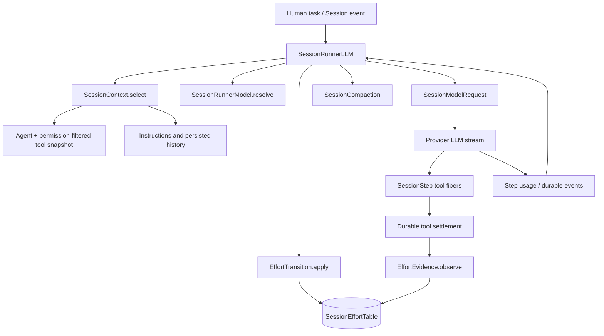

# FiFeCode harness: code-linked gap analysis and protected strengths

**Research date:** November 2, 2026 (America/Los_Angeles)  
**Target:** [`DeputyFifeofMayberry/opencode_fife`](https://github.com/DeputyFifeofMayberry/opencode_fife) at pinned `main` commit [`07bae7483b6a7983bae2008407683097235e06c5`](https://github.com/DeputyFifeofMayberry/opencode_fife/commit/07bae7483b6a7983bae2008407683097235e06c5)  
**Phase:** Audit and candidate directions **only**, not implementation planning  
**Related:** [Harness research](harness-engineering-research-2026-11-02.md) · [Evidence ledger](harness-engineering-evidence-ledger-2026-11-02.md)

## 1. What the repository evidence shows

**Highest-priority finding:** Automatic reasoning effort has a source-verified **conditional initialization failure path**. A root session with no explicit variant, using the normal `standard` policy base, need not create a `session_effort` row. Later configured verifier results call SQL `UPDATE`, not `INSERT`, so there is nowhere to persist a failure and no subsequent escalation. Relevant tests all explicitly seed policy state. This is a high-confidence **probable deficiency** until reproduced in a running, representative session. The second probable deficiency is loss of verification observations when a shell command moves to the background and completes through the synthetic-notification path. [GAP-001](#gap-001-default-effort-root-sessions-can-lose-verifier-evidence) and [GAP-002](#gap-002-backgrounded-verification-results-can-bypass-effort-evidence).

The code already has substantial agent-loop, cache, compaction, event persistence, tool supervision, permissions, model resolution and extensibility infrastructure. A large prompt, a growing session, or an absent fashionable feature is **not** evidence of a defect. The user workload is not frequency-measured; no raw API usage export or task-acceptance records were accessible. All claimed benefits are therefore **unmeasured**. No tests were run and no files in the fork were changed.

### Classification accounting

| Category | IDs | Count | Meaning |
|---|---|---:|---|
| Confirmed deficiency (documentation consistency) | GAP-008 | 1 | Direct mismatch in published status/branch-facing guidance, limited practical impact |
| Probable deficiency, code-verified conditional paths | GAP-001, GAP-002 | 2 | Structural mechanism strongly supported; runtime failure frequency not measured |
| Measurement / observability gap | GAP-004 | 1 | Research-accessible evidence cannot tie quality/cost to accepted tasks |
| Architectural risk | GAP-003, GAP-005, GAP-009 | 3 | Source-visible exposures or invariants, not measured user failures |
| Opportunity without demonstrated deficiency | GAP-006, GAP-007 | 2 | Attractive external patterns not justified by comparative task results |
| Insufficient evidence / unknown | GAP-010, GAP-011 | 2 | No defensible finding of deficiency or improvement |
| Existing strengths to preserve | STR-001–STR-007 | 7 | Documented below; these are not gaps |

**No performance regression, quality delta, security exploit, task-level failure rate, or comparative harness advantage was empirically measured.** “Confirmed” means code or document observations exactly as scoped, **not** that this specific user's deployed runtime failed.

## 2. Repository authenticity, divergence and environment

| Property | Evidence | Consequence |
|---|---|---|
| Fork | Public `DeputyFifeofMayberry/opencode_fife`, `main`, SHA `07bae7483b6a7983bae2008407683097235e06c5` | All code links in this report are pinned |
| Upstream | `anomalyco/opencode`, `dev`, SHA `1bf08ae46a91f7793c756e4ee521e37b6b554064` | It is the integration lineage, not an arbitrary peer |
| Merge base | `ed74ec82ce1fe3a36da6c0815a935473ef4bb0fb` | GitHub compare supports independent commit counts |
| Ahead / behind | 97 fork commits ahead, 528 upstream commits behind | Maintenance exposure, not an instruction to merge blindly |
| Package runtime | Monorepo version 2.1.4; Bun 1.4.4 | [Pinned `package.json`](https://github.com/DeputyFifeofMayberry/opencode_fife/blob/07bae7483b6a7983bae2008407683097235e06c5/package.json#L1-L9) |
| Local checkout | `Y:\CodingProjects\opencode_fife` inaccessible: connected Windows computer offline | Uncommitted work, local test results and actual installed version unknown |
| Usage | Raw November 2 export unavailable | Prior user-reported numbers not independently reproduced |

[Direct GitHub compare](https://github.com/anomalyco/opencode/compare/dev...DeputyFifeofMayberry:opencode_fife:main). Compare-file summaries may be limited by GitHub pagination; the review did not individually inspect all 528 upstream commits or all 97 fork commits. The fork differs visibly through `packages/core/src/effort/` and associated tests, rich `.opencode/skills`, `AGENTS.md`, Windows-related CLI tooling, and model-provider files. Most of its core runtime is derived from OpenCode. Exact authorship of every inherited module was **not** reconstructed.

### Runtime/ownership map from inspected source

**Read-only anchors:** [`runner/llm.ts:275–410`](https://github.com/DeputyFifeofMayberry/opencode_fife/blob/07bae7483b6a7983bae2008407683097235e06c5/packages/core/src/session/runner/llm.ts#L275-L410), [`context.ts:126–185`](https://github.com/DeputyFifeofMayberry/opencode_fife/blob/07bae7483b6a7983bae2008407683097235e06c5/packages/core/src/session/context.ts#L126-L185), [`step.ts:115–315`](https://github.com/DeputyFifeofMayberry/opencode_fife/blob/07bae7483b6a7983bae2008407683097235e06c5/packages/core/src/session/runner/step.ts#L115-L315), [`effort/transition.ts:45–109`](https://github.com/DeputyFifeofMayberry/opencode_fife/blob/07bae7483b6a7983bae2008407683097235e06c5/packages/core/src/effort/transition.ts#L45-L109). Session and tool events are durable; the diagram intentionally does not imply synchronous ordering for all concurrent tool completions.

## 3. Domain-by-domain D1–D9 assessment

| Domain | What is directly visible in the fork | Status and confidence | Open question affecting conclusions |
|---|---|---|---|
| **D1 Agent loop** | Prepared steps, provider stream, scoped parallel tool fibers, cancellation/overflow/retry/continuation and durable `Step.Ended` | Substantial existing strength; **REPO-VERIFIED mechanism** | Are terminal states/retries correct in representative crash and permission scenarios? |
| **D2 Context engineering** | Permission-aware instruction selection, stable-prefix ordering, history reconstruction, estimated/measured budgets, compaction, large-output truncation | Existing capability; **REPO-VERIFIED mechanism** | Prompt composition, stale context, quality and real task relevance not measured |
| **D3 Memory and planning** | Durable session event history, context reload, skill discovery, compaction summary of requirements/decisions/work state | Existing capability; task quality **UNKNOWN** | Whether long-horizon memory remains correct across interruption and code changes |
| **D4 Tools and orchestration** | Shell/read/edit/patch/grep/glob/subagent/MCP etc.; permission-filtered snapshot; background shell notifications | Existing infrastructure plus **probable integration gap** | Whether async verifier completions reach all relevant policy consumers |
| **D5 Model/provider routing** | Catalog resolver, agent override and explicit session choice; policy selects reasoning *variant*, not automatically task model | Existing effort mechanism; task-level model routing **not verified** | Whether uncommitted local model router exists, and whether a task router improves accepted results |
| **D6 Caching, latency, costs** | Cache-key/affinity, stable prefix, model-sensitive request shaping, token/cost normalization, background compaction | Strong mechanism visibility; outcomes **UNKNOWN** | Per-task total cost, cold/warm latency and actual cache input composition missing |
| **D7 Security/reliability** | Permission checks, config hooks, interruption settlement, retries, tool file access, snapshot references | Partial source validation; **not a security audit** | Symlink escape, plugin trust, credential handling and Windows shell behavior need authorized tests |
| **D8 Evaluation/observability** | Policy unit tests, store/recovery/evidence tests, step usage logs, session resume telemetry | Coverage exists; task-level quality evidence **unavailable** | Can tool/session/request records be joined to independent accepted-task outcomes? |
| **D9 UX/maintenance** | Monorepo CLI, TUI, app, plugins, Windows-specific code, skills; Git divergence | Strong footprint; upgrade risk **VERIFIED** | Local installed build, TUI experience and upstream integration cost unknown |

**Noteworthy test boundary:** The inspected `effort/evidence.test.ts`, `store.test.ts`, `recovery.test.ts`, `adapter.test.ts` and `policy.test.ts` provide meaningful pure-policy, storage and pre-seeded integration coverage. They do not reproduce ordinary first-use root-session creation without a policy row under a configured verifier. This is a **coverage hole**, not a claim the entire test suite is bad.

## 4. Detailed gap register

### GAP-001: Default-effort root sessions can lose verifier evidence

**Classification:** Probable deficiency · **Priority:** High · **Domain:** D5/D1/D8 · **Status:** Code-verified conditional failure path; execution untested · **Attribution:** Verified mechanism only, not a controlled task effect · **Confidence:** High in the specific code path, unknown real-world prevalence. **Relevant workload:** User-prioritized build/debug/test-verify loops, especially default-auto effort; frequency unknown. **Evidence:** [E-006](harness-engineering-evidence-ledger-2026-11-02.md#material-evidence-register), [E-007](harness-engineering-evidence-ledger-2026-11-02.md#material-evidence-register), [E-008](harness-engineering-evidence-ledger-2026-11-02.md#material-evidence-register), [E-009](harness-engineering-evidence-ledger-2026-11-02.md#material-evidence-register).

**Actual fork behavior.** [`EffortTransition.apply`](https://github.com/DeputyFifeofMayberry/opencode_fife/blob/07bae7483b6a7983bae2008407683097235e06c5/packages/core/src/effort/transition.ts#L45-L96) retrieves an optional state row. When there is no user variant, the policy base is `standard`, and no failure has been recorded, [`EffortAdapter.decideFor`](https://github.com/DeputyFifeofMayberry/opencode_fife/blob/07bae7483b6a7983bae2008407683097235e06c5/packages/core/src/effort/adapter.ts#L59-L73) returns a decision with **no explicit variant**. Transition returns immediately on `target === variant`, without creating a row. [`EffortEvidence.observe`](https://github.com/DeputyFifeofMayberry/opencode_fife/blob/07bae7483b6a7983bae2008407683097235e06c5/packages/core/src/effort/evidence.ts#L33-L62) later recognizes a configured verifier's nonzero exit and calls `setOpenFailure`; [`EffortStore.setOpenFailure`](https://github.com/DeputyFifeofMayberry/opencode_fife/blob/07bae7483b6a7983bae2008407683097235e06c5/packages/core/src/effort/store.ts#L89-L111) is a plain SQL UPDATE, not an upsert. On an absent row, it updates **zero rows**. `bumpRevision` has the same absent-row issue. The root `Session.session.ts` path inspected did not show row seeding; [`EffortDelegation.seed`](https://github.com/DeputyFifeofMayberry/opencode_fife/blob/07bae7483b6a7983bae2008407683097235e06c5/packages/core/src/effort/delegation.ts#L36-L53) creates rows for eligible **children**, not ordinary roots.

**Why tests can miss this.** The fixture helper in [`packages/core/test/effort/evidence.test.ts`](https://github.com/DeputyFifeofMayberry/opencode_fife/blob/07bae7483b6a7983bae2008407683097235e06c5/packages/core/test/effort/evidence.test.ts#L42-L61) calls `efforts.set` before every verifier test. The [`adapter.test.ts`](https://github.com/DeputyFifeofMayberry/opencode_fife/blob/07bae7483b6a7983bae2008407683097235e06c5/packages/core/test/effort/adapter.test.ts) explicitly expects no variant at default standard effort. The necessary combination—**unseeded root → failing configured shell verifier → later effort decision**—is not covered by those tests.

**Potential user consequence.** Automatic escalation may remain off precisely when a verifier first fails in a normal default-effort session, despite the feature's stated intent. The number of affected sessions, model compatibility, and real quality impact are unmeasured. A session that has already acquired a row (e.g., after plan-mode pinning or child delegation) can behave differently.

**Competing explanations / uncertainty.** An initialization path outside the inspected files, a local uncommitted change, or a configured non-default initial effort could populate the row. Check these before interpreting any real session failure. The source-path result does not establish an actual failure on the user's current machine.

**Alternatives for later evaluation, not tasks:** Retain current behavior only if existing runtime seeding is demonstrated; configuration or known upstream state ownership reuse; consistent initial state ownership; or atomic persistence semantics that tolerate absent rows. A wholesale model-routing refactor is not necessary to address the narrow concern. Tradeoffs: writes for sessions with no policy benefit, stale state on model switch, migrations, concurrent update behavior and compatibility with manual exact picks.

**Future discriminating verification:** An isolated fixture with a fresh, normal root session, a model advertising multiple effort levels, configured verifier, default base, failed then passed verification, and event/state assertions. Measure both presence of a `session_effort` row and actual emitted `ModelSelected`/`EffortTransitioned` events after failure. Include interrupted requests and model switches; compare current published code with a known no-change control. No such test was executed. **Task acceptance:** Verification outcome recorded and intended effort transition visible without changing user-selected exact variants; count affected task IDs and verification episodes, not model calls.

### GAP-002: Backgrounded verification results can bypass effort evidence

**Classification:** Probable deficiency · **Priority:** Medium–High, conditional on backgrounded verifier use · **Domain:** D1/D4/D5 · **Attribution:** Verified event-path difference; runtime coverage not measured · **Confidence:** Medium–high. **Relevant workload:** Long PowerShell builds, tests and checks using automatic background shell jobs; observed frequency unknown. **Evidence:** [E-010–E-012](harness-engineering-evidence-ledger-2026-11-02.md#material-evidence-register).

**Actual fork behavior.** [`ShellTool`](https://github.com/DeputyFifeofMayberry/opencode_fife/blob/07bae7483b6a7983bae2008407683097235e06c5/packages/core/src/tool/plugin/shell.ts#L199-L285) may return a **running** background result explicitly or after an auto-background threshold. That immediate result lacks the completed command's final exit. The job's eventual exit is surfaced via [`notifyWhenDone`](https://github.com/DeputyFifeofMayberry/opencode_fife/blob/07bae7483b6a7983bae2008407683097235e06c5/packages/core/src/tool/plugin/shell.ts#L159-L190), which sends a **synthetic session notification** containing terminal state/metadata. By contrast, verifier policy observations in [`SessionStep`](https://github.com/DeputyFifeofMayberry/opencode_fife/blob/07bae7483b6a7983bae2008407683097235e06c5/packages/core/src/session/runner/step.ts#L129-L154) are attached to settled tool executions; [`exitOf`](https://github.com/DeputyFifeofMayberry/opencode_fife/blob/07bae7483b6a7983bae2008407683097235e06c5/packages/core/src/effort/evidence.ts#L80-L86) requires a numeric exit. This visible path offers no obvious second call to `EffortEvidence.observe` after the delayed completion.

**Root-cause hypothesis.** Event-path ownership is split: a background completion is an observable user event but is not necessarily a policy observation. It might therefore fail to open or clear escalation. Separately verify whether any other subscriber routes synthetic events to the policy before classifying this as an unconditional runtime bug.

**Alternatives:** Retain if verification never runs backgrounded in the user's workflow; use existing durable job status as an observation source; compare an explicit finished-command event with the current notification semantics; or narrowly adapt verifier contracts. Weigh duplicate observations, idempotency, replay, cancellation and late completion after session closure.

**Future validation:** Isolated test with `shell` verifier below/above auto-background threshold, explicit `background:true`, zero and nonzero exits, cancellation, and same-verifier recovery. Compare final job outcome, policy row, durable events and request effort. Baseline denominator = **configured verifier jobs reaching completion**, stratified by foreground/background. No experiment performed.

### GAP-003: Upstream divergence creates significant integration exposure

**Classification:** Architectural risk · **Priority:** High for long-term stability · **Domain:** D9/D7/D5 · **Attribution:** Verified Git topology only · **Confidence:** High in counts, unknown effect magnitude. **Relevant workload:** Maintaining this personal fork and integrating model/Windows/provider updates; no measured upgrade effort. **Evidence:** [E-001–E-003](harness-engineering-evidence-ledger-2026-11-02.md#material-evidence-register).

**Observation.** GitHub compare places the published fork **97 ahead, 528 behind** the `anomalyco/opencode` `dev` tip at the recorded SHAs, merge-base `ed74ec82...`. The fork's bespoke effort policy, skill guidance, Windows work and provider changes can conflict with evolving upstream APIs. This is a structural maintenance exposure, not proof the current runtime fails or that merging 528 commits yields better UX.

**Alternatives:** Preserve current pinned base when reliable; selectively consume upstream fixes or stable extension seams; reuse upstream capabilities where suitable; or assess a major convergence only with a demonstrable maintenance/quality benefit. No merge schedule or change list is authorized here. **Future validation:** Categorize upstream changes touching actual fork integration boundaries, identify critical security/provider compatibility fixes, and compare conflict cost/defect recurrence versus benefits. Measure maintenance hours and regressions across real merges, not commit count alone.

### GAP-004: No accessible accepted-task outcome/cost baseline

**Classification:** Measurement/observability gap · **Priority:** High as a decision prerequisite · **Domain:** D8/D6 · **Attribution:** Unavailable measurement, not a claim the product has zero logging · **Confidence:** High regarding evidence absent from this research. **Relevant workload:** All scenario classes; task distribution unknown. **Evidence:** [E-013](harness-engineering-evidence-ledger-2026-11-02.md#material-evidence-register).

**Observation.** The source supports request/step token accounting and resume telemetry; no accessible records link user task objective, human/test acceptance, final diff, retries/child calls, total cost and elapsed wall time. Previously reported November 2 usage metrics remain **not reproduced**. There is no defensible task-level baseline from which to assert that context compression, routing or extra agents will improve user outcomes. This is a missing **evidence contract** in this execution, not a verified missing logger implementation.

**Alternatives:** Retain existing event accounting and combine with an independently labeled task acceptance record; use privacy-safe read-only exports; use prospective public fixtures if user work cannot be observed. The minimal future schema needs task ID, session/request/tool/child linkage, timestamps, model version, provider API, price source, acceptance rubric/result, and end-to-end rework/cost. Guardrails: secrets, sensitive code, consent, accidental instrumentation overhead. **Future validation:** Trace a small but representative task through the existing event graph and determine whether correct task cost and acceptance can be reconstructed; report missingness, not false zero values. No telemetry installed.

### GAP-005: Revision tracking may not cover shell-driven file mutations

**Classification:** Architectural risk · **Priority:** Medium · **Domain:** D1/D5/D7 · **Attribution:** Verified configuration-bound mechanism; effect unmeasured · **Confidence:** Medium. **Relevant workload:** Debugging where the agent edits through shell or external processes; frequency unknown. **Evidence:** [E-011](harness-engineering-evidence-ledger-2026-11-02.md#material-evidence-register).

**Observation.** [`EffortEvidence.observe`](https://github.com/DeputyFifeofMayberry/opencode_fife/blob/07bae7483b6a7983bae2008407683097235e06c5/packages/core/src/effort/evidence.ts#L30-L62) increments the policy's logical revision for a default list `write`, `edit`, `patch`; the set is configurable. This tracks certain **tool settlements**, not an authoritative Git/worktree revision. Shell commands and external editors may change files without increasing this counter. The pure policy requires a passing verifier's revision not be older than the earlier failure, but an unchanged logical counter alone cannot prove two verifier executions saw an identical filesystem state.

**Competing explanations:** The policy explicitly uses this surrogate revision only as an ordering guard; durable event sequence separately protects against prior observations. The representation may be sufficient for the actual desired semantics. Do not assert unsafe escalation clearing without controlled interleavings. **Alternatives:** Retain simple logical counter, configure mutation classifications, or compare narrower worktree evidence/validation timestamps; avoid expensive broad filesystem hashing without demonstrated need. **Future validation:** Paired foreground shell-edit and dedicated edit scenarios, concurrent tool settlement, independent filesystem/revision snapshot, stale verifier return. Define the exact safety invariant before choosing an observation mechanism.

### GAP-006: Budgeted repository maps may be useful, but a search deficiency is unproven

**Classification:** Opportunity without demonstrated deficiency · **Priority:** Medium–Low · **Domain:** D2/D4 · **Attribution:** External documented mechanism plus applicability hypothesis · **Confidence:** High mechanism, low FiFeCode benefit. **Relevant workload:** Large-repository exploration/refactor, user-prioritized but frequency unknown. **Evidence:** [E-019](harness-engineering-evidence-ledger-2026-11-02.md#material-evidence-register).

**Observation.** Aider documents Tree-sitter symbol/dependency graph ranking under an adjustable token budget. FiFeCode has glob/grep/read, dynamic context, CodeMode and plugin mechanisms. The user has not supplied cases where current navigation loses a necessary symbol or requires disproportionate retries. An added index could become stale, conflict with git branches or consume CPU/storage on Windows.

**Alternatives:** Retain search, improve tool use/configuration, reuse upstream/LSP capabilities, prototype lightweight maps outside the fork for fair comparison, or larger index only with measured gains. **Validation:** Cross-file tasks with independently known relevant symbols; precision/recall of delivered context, accepted-task correctness, latency, added tokens, cache stability and index freshness. Do not equate a shorter prompt with an improved outcome.

### GAP-007: Adaptive task-level model routing is an unvalidated opportunity

**Classification:** Opportunity without demonstrated deficiency · **Priority:** Medium pending data · **Domain:** D5/D6 · **Attribution:** Selected source path verified; broader absence and benefit undetermined · **Confidence:** Medium about published runner path, low about overall need. **Relevant workload:** User-stated cheap/simple versus premium/difficult tasks. **Evidence:** [E-014](harness-engineering-evidence-ledger-2026-11-02.md#material-evidence-register).

**Observation.** [`SessionRunnerModel.resolve`](https://github.com/DeputyFifeofMayberry/opencode_fife/blob/07bae7483b6a7983bae2008407683097235e06c5/packages/core/src/session/runner/model.ts#L80-L120) selects a configured agent model or default model; exact user session picks remain stable. The fork separately adapts **reasoning effort**, not necessarily model tier. Published `main` does not include the newer November 2 tier-simulation specs described in the user prompt. This does **not** prove no external/local model router exists.

**Alternatives:** Retain manual/agent model choices, make existing configuration easier, use bounded escalation after verifiable failure, or compare more dynamic routers. Any router must account for misrouting, tool-format capability, provider subscription cost, extra classification overhead and the risk of repeated premium fallbacks. **Validation:** Same task distribution with randomized/counterbalanced router/no-router assignments; success, total cost per accepted task, time, retries, overrides, escalation false positives, model identity, and provider cache effects. No financial or quality gain is asserted.

### GAP-008: Published instructions and design status are inconsistent

**Classification:** Confirmed deficiency, limited to documentation and reader expectations · **Priority:** Low–Medium · **Domain:** D9/D3 · **Attribution:** Direct document/repository metadata comparison · **Confidence:** High on mismatch, low on operational harm. **Relevant workload:** Agents following repo instructions, onboarding, upstream merges. **Evidence:** [E-002, E-015](harness-engineering-evidence-ledger-2026-11-02.md#material-evidence-register).

**Observation.** [`AGENTS.md:4`](https://github.com/DeputyFifeofMayberry/opencode_fife/blob/07bae7483b6a7983bae2008407683097235e06c5/AGENTS.md#L1-L5) states that `dev` is the default and worktrees/PRs should target `origin/dev`; GitHub metadata says the **fork** default is `main`. This could be deliberate guidance for contributing to **upstream**, but is ambiguous for a fork-maintainer agent. [`docs/spec/effort-policy.md:3`](https://github.com/DeputyFifeofMayberry/opencode_fife/blob/07bae7483b6a7983bae2008407683097235e06c5/docs/spec/effort-policy.md#L1-L9) says “Draft — awaiting approval,” although an effort-policy PR was merged and code plus tests exist; the intent doc has confirmed status. These conflicting states are directly visible.

**Alternatives:** Retain `dev` as deliberate upstream contribution rule but explicitly scope it; or clarify fork versus upstream branch guidance and historical document status in future work. **Future validation:** Have a read-only fresh agent identify the correct base/target branch and whether the feature is shipped; compare with actual maintainer intent. No changes made.

### GAP-009: Nested-fork prompt-cache lineage is explicitly unresolved

**Classification:** Architectural risk · **Priority:** Low until substantiated · **Domain:** D2/D6 · **Attribution:** Verified in-source TODO, no measured cache effect · **Confidence:** High that TODO exists, low that it affects user's outcomes. **Evidence:** [E-016](harness-engineering-evidence-ledger-2026-11-02.md#material-evidence-register).

**Observation.** [`SessionModelRequest`](https://github.com/DeputyFifeofMayberry/opencode_fife/blob/07bae7483b6a7983bae2008407683097235e06c5/packages/core/src/session/model-request.ts#L324-L349) sets `promptCacheKey` from session affinity, with the explicit source TODO: “Persist cache lineage so nested forks reuse the root session's cache key.” This establishes developer awareness of a limitation, not that current provider caching is poor or a new mechanism is necessary. Some providers do not use this key at all.

**Alternatives:** Preserve provider defaults, examine current native prefix usage and fork frequency, or investigate bounded lineage propagation without violating user/session privacy boundaries. **Future validation:** Compare same-provider warm/cold cache behavior between root and forked session under known cache semantics; count task-level cost/latency, not arbitrary hit-rate increase.

### GAP-010: DeepSeek provider/harness advantage remains unverified

**Classification:** Insufficient evidence · **Priority:** Research condition, not an implementation priority · **Domain:** D5/D6/D8 · **Attribution:** Provider/model/harness conflation risk · **Confidence:** High in dated API alias; effect unknown. **Evidence:** [E-023–E-025](harness-engineering-evidence-ledger-2026-11-02.md#material-evidence-register).

**Observation.** DeepSeek's October 17 change log identifies the live Flash variant behind `deepseek-flash`; the official harness is a developer preview. DeepSeek's published benchmarks mention differing harness setups. The same model through native harness, Codex and OpenCode/FiFeCode cannot be considered equivalent unless request serialization, tool schemas, reasoning controls, budgets and provider settings are verified. No comparative test was run and no FiFeCode-specific DeepSeek incompatibility was reproduced.

**Discriminating evidence:** Record API response model/version, transport, actual tool calls and context, then perform matched endpoint/fixture comparisons with equivalent permissions. Treat incompatibilities as non-equivalent conditions, not pure harness effects. Retain the currently working model integration in the absence of a demonstrated deficit.

### GAP-011: Context growth is unexplained, not a confirmed compaction failure

**Classification:** Insufficient evidence · **Priority:** Measurement prerequisite · **Domain:** D2/D6/D8 · **Attribution:** Undetermined · **Confidence:** High that conclusions are underdetermined. **Evidence:** [E-004, E-005, E-013](harness-engineering-evidence-ledger-2026-11-02.md#material-evidence-register).

**Observation.** The fork already compacts context, has a provider-limit reserve, background summaries and output truncation. The ZIP underlying previously quoted request/token totals was not available, and no per-request input-composition or quality outcome was observed. Increasing hourly mean input tokens, even if accurately reported, can reflect a continuing task, retained correct context, model/provider charging differences, legitimate cache reuse, or needless repetition.

**Discriminating evidence:** Reproduce raw request/session tokens, context segment composition, cold/warm cache, latency, retries and accepted-task outcome on a stable model/provider version. Do not automatically enable more aggressive compression, retrieval or memory layers on the basis of input growth alone.

## 5. Root-cause hypothesis and disconfirmation register

| ID | Hypothesis | Strongest supporting observation | What could disprove it | Status |
|---|---|---|---|---|
| H-01 | Unseeded `session_effort` rows prevent default-root verifier escalation | Transition no-change return + store SQL UPDATE + pre-seeded tests | Another root-session seeder or verified normal root reproduction showing policy row and transition | Strong source-based inference, unrun |
| H-02 | Background verifier completion bypasses observer | Shell returns running state and later emits synthetic, observer linked to settled foreground event | Another event consumer calls `EffortEvidence.observe` for final job notification | Probable, full event search incomplete |
| H-03 | Logical revision omits shell changes and can misclassify stale pass | Default mutating tool list excludes shell | Empirical guarantee via sequence/state policies that excludes this failure scenario | Risk, not demonstrated incident |
| H-04 | High context growth reflects duplicate/irrelevant context | Prior reported large prompts only | Detailed composition proves legitimate state; no quality/time harm | Unsupported hypothesis |
| H-05 | Task-tier routing reduces accepted-task cost | User-prioritized simple vs hard model allocation | Paired tasks show increased failures, retries, overhead or negligible spend difference | Untested opportunity |
| H-06 | DeepSeek Harness yields better DeepSeek results | Vendor-designed adapter and model claims | Same-model, same-task controlled comparisons show parity or opposite | Untested, cannot assume |
| H-07 | Upstream divergence imposes unacceptable maintenance | 528 behind at recorded branch tips | Version remains stable with acceptable repair overhead and no missing critical fixes | Exposure verified; effect unknown |

## 6. Current strengths, protected invariants and false gaps ruled out

- **STR-001—Durable, interruptible agent loop:** runner, streaming steps, tool settlement, retries, output-limit continuation, and overflow recovery exist. Preserve explicit terminal states, cancellation and session continuity. [`runner/step.ts`](https://github.com/DeputyFifeofMayberry/opencode_fife/blob/07bae7483b6a7983bae2008407683097235e06c5/packages/core/src/session/runner/step.ts).
- **STR-002—Real compaction:** automatic/manual policies, 15%/16k context reserve, precomputed background summaries and overflow fallback are not missing. Preserve decisions/constraints and provider cache conditions pending quality evidence. [`compaction.ts`](https://github.com/DeputyFifeofMayberry/opencode_fife/blob/07bae7483b6a7983bae2008407683097235e06c5/packages/core/src/session/compaction.ts#L42-L168).
- **STR-003—Provider-conscious caching and accounting:** cache key/affinity, coherent prefix ordering, token read/write/reasoning normalization, and provider cost preference exist. Preserve actual provider semantics. [`model-request.ts`](https://github.com/DeputyFifeofMayberry/opencode_fife/blob/07bae7483b6a7983bae2008407683097235e06c5/packages/core/src/session/model-request.ts#L324-L352) and [`usage.ts`](https://github.com/DeputyFifeofMayberry/opencode_fife/blob/07bae7483b6a7983bae2008407683097235e06c5/packages/core/src/session/usage.ts#L11-L54).
- **STR-004—Scoped tool exposure:** current agent/session permissions narrow tool snapshots, skill and MCP discovery. Do not turn every tool on merely to imitate a peer. [`context.ts`](https://github.com/DeputyFifeofMayberry/opencode_fife/blob/07bae7483b6a7983bae2008407683097235e06c5/packages/core/src/session/context.ts#L126-L166).
- **STR-005—Explicit manual-model/effort precedence:** exact user picks should not be silently overridden by adaptive rules. [`effort/transition.ts`](https://github.com/DeputyFifeofMayberry/opencode_fife/blob/07bae7483b6a7983bae2008407683097235e06c5/packages/core/src/effort/transition.ts#L45-L76) and [`policy.ts`](https://github.com/DeputyFifeofMayberry/opencode_fife/blob/07bae7483b6a7983bae2008407683097235e06c5/packages/core/src/effort/policy/policy.ts).
- **STR-006—Reusable extension surfaces:** plugins, hooks, skills, subagents, read/edit/search/shell tools and MCP are represented by actual registered source modules rather than promises in a README. Preserve safety/lifecycle contracts while measuring if individual features are helpful. [`config/plugin`](https://github.com/DeputyFifeofMayberry/opencode_fife/tree/07bae7483b6a7983bae2008407683097235e06c5/packages/core/src/config/plugin).
- **STR-007—Existing focused tests:** effort policy, adapter, storage, evidence, delegation and recovery test files exist and express useful invariants. Add test coverage only after verifying gaps; do not replace them merely because they do not cover every path. [`test/effort`](https://github.com/DeputyFifeofMayberry/opencode_fife/tree/07bae7483b6a7983bae2008407683097235e06c5/packages/core/test/effort).

**Apparent gaps ruled out by inspection:** “No context compaction,” “no provider caching support,” “no agent delegation,” “no hooks/skills,” “no effort-policy logic,” “no session recovery,” and “no tests for policy decision rules” are unsupported assertions. The right research question is narrower: which paths work under actual task failures, and do they improve accepted-task outcomes?

## 7. Planning-facing ranked research findings, not an implementation sequence

This order is **decision priority**, not work scheduling or authorization to edit code.

| Rank | Finding | Why it rises / falls | Planning evidence still needed |
|---|---|---|---|
| 1 | **GAP-001** default-root effort state | Direct conditional failure path, tightly scoped and testable; affects purpose of custom feature | Root initialization census; isolated reproduction and acceptable state semantics |
| 2 | **GAP-004** accepted-task baseline | Without acceptance and cost attribution, no credible performance optimization decision | Task identity schema, permissioned traces, review outcomes and missingness |
| 3 | **GAP-003** upstream divergence | Highest ongoing maintenance exposure for an inherited runtime | Change impact/conflict map across fork ownership boundaries |
| 4 | **GAP-002** background verifier evidence | Source-linked conditional signal loss; important if builds often background | Real job patterns, event ownership, no double-counting proof |
| 5 | **GAP-005** mutation revision semantics | Possible stale-state correctness concern; not an incident yet | Interleavings, precise invariant, actual shell-mutation frequency |
| 6 | **GAP-008** doc/branch status | Directly visible, inexpensive to clarify later, low performance consequence | Intended Git target and whether spec is historical |
| 7 | **GAP-007 / GAP-006 / GAP-009** routing, map, cache lineage | Potential upside, but new dependencies and uncertain value | Task-stratified experiments against no-change controls |
| — | **GAP-010 / GAP-011** DeepSeek and context | Investigate before declaring a defect or winner | Raw compatible-provider traces and outcome data |

The most important **counter-recommendation** is to avoid building a second context system, wholesale adopting DeepSeek Harness, or making automatic model routing a universal requirement until the fork's existing boundaries and the user's actual acceptance outcomes justify the added maintenance. This is a research-level decision constraint, not an implementation plan.

## 8. Future validation designs and blocked work

**Isolated source-validation experiments (not performed):** root-session effort initialization with verifier fail/pass; auto-backgrounded shell completion; revision consistency under shell edits; retry and tool interruption after output begins; cached warm/cold long session versus summary; model-provider tool/parsing parity, and representative Windows SSH shell behavior. Each should use a **copy/fixture**, locked source SHA, exact model/API, a fixed budget and no secrets. Include no-change controls and observable durable events. Never run unsafe shell commands against real customer/work repositories without appropriate authorization.

**Cost/quality comparison design:** predeclare independent task acceptance rubric; capture complete task lifecycle, multiple model requests, subagents, provider cache read/write costs and paid tool costs; report numerator/denominator and percentile time; randomize/counterbalance condition order and document environmental drift. Compare exactly one high-impact mechanism at a time where possible. If experiments are underpowered or tool/provider behavior differs, call the result inconclusive.

**Blocked:** local unpublished checkout, installed plugin configuration, local Windows tests, real usage ZIP, accepted-task frequency, provider billing specifics, code-level parity tests for DeepSeek, comprehensive peer-source audit, security penetration testing. There is no evidence that any of these activities was completed during this research. Actual source-specific conclusions remain bounded to published commit `07bae748...`.

## 9. Read-only verification statement

Inspection used public GitHub read-only repository/file/compare endpoints and first-party external technical documents. No target files, tests, branches, build products, remotes, issues or PRs were changed. **No implementation plan was produced.** The linked [evidence ledger](harness-engineering-evidence-ledger-2026-11-02.md) records source addresses, evidence classes, chronology, unresolved leads and the method's coverage limits.
