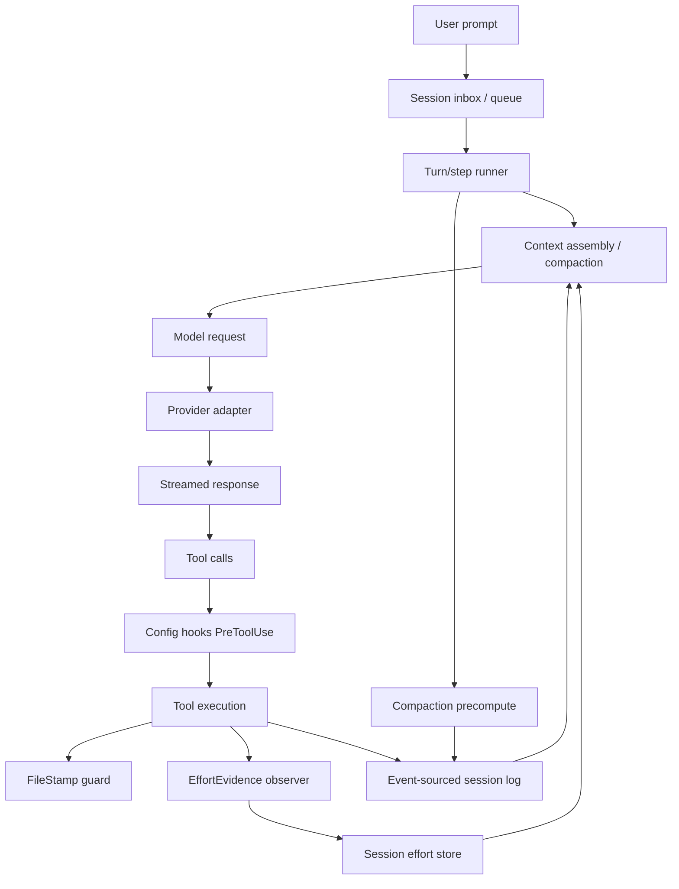

# Research deliverables — `opencode_fife` harness audit

**Execution date:** 2026-11-02  
**Target:** [`DeputyFifeofMayberry/opencode_fife`](https://github.com/DeputyFifeofMayberry/opencode_fife)  
**Fork revision inspected:** `07bae7483b6a7983bae2008407683097235e06c5` (`main`)  
**Upstream revision compared:** `anomalyco/opencode` `1bf08ae46a91f7793c756e4ee521e37b6b554064` (`dev`)  
**Merge base:** `ed74ec82ce1fe3a36da6c0815a935473ef4bb0fb` (2026-10-26)

> **Access limitation:** the local checkout at `Y:\CodingProjects\opencode_fife` was not reachable from this environment. The fork was inspected read-only through its public GitHub repository, API, and raw files at the pinned SHA above. No tests were run, no telemetry export was available, and no repository state was changed. External closed-source internals were not inspectable; claims about Claude Code, Codex hosted behavior, and DeepSeek Harness beyond public source/docs are labelled accordingly.

---

# A. `harness-engineering-research-2026-11-02.md`

## 1. Scope, baseline, and confidence

### 1.1 What was inspected

| Area | Inspected | Evidence level |
|---|---|---|
| Fork identity, divergence, commits | GitHub API, compare API, commit patches | REPO-VERIFIED |
| Fork custom features | effort policy code/spec, config hooks, stale-edit commit, `step.ts` integration | REPO-VERIFIED |
| Fork inherited runtime | `packages/core/src/session/compaction.ts`, `step.ts`, agent docs | REPO-VERIFIED / UPSTREAM-VERIFIED |
| Upstream OpenCode | `dev` HEAD, compaction, agents docs, session V2 design | UPSTREAM-VERIFIED / DOCUMENTED |
| Claude Code | official context-window, hooks, subagent docs | DOCUMENTED |
| Codex | open-source `compact.rs`, official compaction API/search results | UPSTREAM-VERIFIED / DOCUMENTED |
| DeepSeek Harness | README, architecture, core, session, compaction docs, pricing, KV-cache docs | DOCUMENTED |
| Other harnesses | discovery only (search results, project pages) | THIRD-PARTY / DISCOVERED |
| Prior usage figures | not reproducible; export unavailable | UNKNOWN |

### 1.2 Confidence statement

The fork’s **structure and custom code** are inspectable with high confidence at the pinned SHA. The fork’s **runtime behavior**, **task-level effectiveness**, and **cost/quality outcomes** are not measured. External systems’ public source is inspectable at the level cited; their hosted behavior and internal evaluation data are not. The prior November 2 usage figures remain **not independently reproduced**.

---

## 2. Executive findings

### Finding 1 — The fork is not a thin fork; it contains substantive custom engineering.

At `07bae748`, the fork contains at least four material custom capabilities beyond upstream:

1. **Effort policy** — automatic reasoning-effort escalation when a configured verification command fails, with delegation minimums and plan-mode pinning.
2. **Stale-edit guard** — refuses edits when a file changed since the session read it.
3. **Config hooks** — Claude Code-compatible `PreToolUse` shell hooks with exit-code and JSON-envelope semantics.
4. **Windows OpenTUI DLL loading fix** — a platform-specific packaging fix.

It also adds agent skills/references under `.opencode/` and a substantial effort-policy test suite. This is real work, not configuration-only.

### Finding 2 — The dominant risk is upstream divergence, not missing features.

The compare API reports:

- **97 commits ahead** of upstream `dev`
- **528 commits behind** upstream `dev`
- status: **`diverged`**

The merge base is 2026-10-26. Upstream HEAD is 2026-11-02. The fork’s `main` is therefore a week-old snapshot plus custom work, while upstream has moved 528 commits. This creates merge friction, potential duplication of upstream fixes, and a growing surface for regressions. It is the highest-priority architectural risk in this audit.

### Finding 3 — The effort policy is plausible and well-tested at unit level, but its task-level benefit is unproven and its cost behavior is open-ended.

The fork’s effort policy:

- maps `low` / `standard` / `deep` to model-advertised variants;
- escalates one level while a configured verifier fails;
- clears only when the same verifier passes at a later sequence and not-older revision;
- seeds subagents at operation-specific starting levels;
- pins plan mode to `deep`;
- persists per-session state in SQLite;
- routes transitions through `Session.switchModel` to preserve provider cache markers.

The author reports **53/53 effort suites**, **241/241 session-runner scenarios**, and **17/17 subagent suites** in PR #9. Those are author-reported test results, not independently reproduced. The PR also says the live smoke run hit a quota error before completing the end-to-end escalation leg. There is **no task-level evidence** that escalation improves accepted-task success, reduces rework, or is worth its latency/cost.

The policy also has no upper bound on how long an unresolved verifier failure keeps effort escalated. If the verifier never passes, the session remains at `deep`, increasing cost and latency without a stopping rule.

### Finding 4 — The fork’s config hooks are a real extensibility mechanism, but they cover only a fraction of the hook surface that Claude Code and Codex expose.

The fork’s `config-hooks.ts` implements a **`PreToolUse`** hook runner with:

- Claude Code-compatible exit codes: `2` blocks with stderr as the model-facing reason; `49` halts the turn;
- stdout JSON envelope supporting `allow` / `deny`, `updatedInput`, and `context`;
- 60-second timeout, 1 MB stdout cap, 64 KB stderr cap;
- concurrent execution and config-order verdict combination.

Claude Code’s public hook reference exposes many more events: `SessionStart`, `UserPromptSubmit`, `PreToolUse`, `PermissionRequest`, `PostToolUse`, `PostToolUseFailure`, `PostToolBatch`, `Stop`, `StopFailure`, `PreCompact`, `PostCompact`, etc. Codex’s `compact.rs` imports `PreCompactHookOutcome` and `PostCompactHookOutcome`. The fork’s hook system is therefore a **useful first slice**, not parity.

### Finding 5 — The stale-edit guard improves safety, but its protection is process-local and has a TOCTOU window.

The fork’s `FileStamp` service records `mtimeMs`, `size`, and a SHA-256 hash per session/path, checks before edits, refreshes after successful mutations, and clears after deletion. That is a meaningful improvement over blind overwrites.

However, the commit documentation states the stamps live in an **in-memory `Map` keyed by session and absolute path**, because “sessions are process-local.” That means:

- after a restart, the session has no record of files it read before restart;
- an external change made while the process was stopped is not detected;
- the check-then-write sequence is not atomic, so an external writer can still race the edit;
- no file locking or compare-and-swap write is present in the inspected code.

This is a **probable deficiency** for long-running or resumed sessions, not a confirmed failure in normal use.

### Finding 6 — The fork’s compaction is inherited from OpenCode V2 and is reasonably sophisticated, but it is older than upstream’s.

The fork’s `compaction.ts` supports:

- automatic, overflow, and manual triggers;
- a free-space buffer (default 15%, at least 16k);
- verbatim recent-context retention (`keep`);
- background summary precomputation (`precompute`);
- provider-overflow detection and retry/recovery integration;
- summarization through the LLM with structured replacement of older history.

Upstream’s `compaction.ts` adds `buffer?: number | string` (percentage strings such as `"20%"`) and a `Clock` import. The fork only accepts a numeric buffer. This is a concrete example of feature lag caused by divergence.

### Finding 7 — The prior usage numbers cannot support a compaction diagnosis.

The previously reported figures — 288 requests, 35.91M input tokens, 34.79M cached tokens, 96.89% aggregate cache hit rate, rising average input per request from 58,692 to 148,261, and ~$0.4395 spend — are **not independently reproduced**. The export `usage_data_2026-11-02_2026-11-02.zip` was not available.

Even if those figures were accurate, they do **not** establish waste or a compaction defect. A rising average input per request can result from:

- a single long-running session with legitimate retained state;
- tool-output accumulation;
- repeated file reads;
- subagent handoffs;
- cache-friendly prefix retention;
- provider-side token accounting;
- or a genuine harness-side context-retention problem.

The correct conclusion is **underdetermined**. The missing evidence is task-level input composition, session IDs, accepted-task outcomes, and per-request latency — not another token average.

### Finding 8 — DeepSeek’s prefix caching makes prefix stability a first-class harness concern, and the fork’s effort policy claims to preserve it without measuring it.

DeepSeek’s official KV-cache documentation states that caching is enabled by default, that a request hits only if it **fully matches a persisted cache prefix unit**, and that prefixes are persisted at request boundaries, through common-prefix detection, and at fixed token intervals. This means:

- changing the model or effort variant can invalidate the prefix;
- inserting volatile content before stable content can destroy cache reuse;
- compaction that rewrites the prompt prefix can wipe the cache;
- measuring cache hit rate without measuring prefix stability is insufficient.

The fork’s effort policy explicitly routes transitions through `Session.switchModel` and the `Message.effort` marker to preserve cache markers, and the PR claims “effort switches preserve the provider prompt cache (existing transport).” That is a **design assertion**, not a measured result. No cache-hit comparison between escalated and non-escalated turns was available.

---

## 3. Definition of an effective coding harness

For this user’s context — a personal, Windows-centered, multi-model CLI — an effective harness is not “the one with the most features.” It is the one that maximizes **accepted-task completion per unit of user time and money**, while maintaining:

| Dimension | What “good” looks like | What can falsely look good |
|---|---|---|
| Task effectiveness | Correct, accepted output; low rework; long-horizon coherence | High token throughput, many tool calls |
| Speed | Low time-to-first-useful-action and low tail completion time | Fast first token with long tool stalls |
| Cost efficiency | Low total cost per accepted task, including retries/compaction | Low per-request cost with high rework |
| Reliability/safety | Deterministic tool contracts, resumability, containment | Aggressive automation that hides failures |
| Usability/control | Clear steering, observability, interruptibility | A feature-rich UI that obscures state |
| Maintainability | Low upstream merge friction, stable contracts | A large custom fork that cannot rebase |

The evidence across Claude Code, Codex, DeepSeek Harness, and OpenCode converges on a few mechanisms that matter more than brand:

1. **Event-sourced or append-only session state** with derived model-visible history, so compaction and replay are auditable.
2. **Explicit compaction as a lifecycle event**, not an ad-hoc truncation, with hooks or locks around it.
3. **Context isolation for subagents**, so exploration does not flood the main window.
4. **Cache-aware prompt construction**, because provider prefix caching rewards stable prefixes.
5. **Tool execution with approval/sandbox boundaries**, because coding agents execute arbitrary commands.
6. **Observability at the task level**, not just request/token counters.

The fork already has several of these through OpenCode V2. Its gaps are less about missing grand architecture and more about **integration, measurement, and upstream drift**.

---

## 4. Research methodology and source quality

### 4.1 Discovery and screening protocol

| Stage | Action | Result |
|---|---|---|
| Anchor identification | Verified Claude Code, Codex, DeepSeek Harness, upstream OpenCode | All four anchors have explicit reviews |
| Fork identity | API metadata, compare API, commit patches, raw files | Fork pinned at `07bae748` |
| Fork feature inventory | Commit messages, PR #9, patches, source files | Four custom features identified |
| Peer mechanism search | Official docs, source files, architecture docs | Mechanisms anchored to code/docs |
| Literature search | Search for compaction, caching, context-cost studies | Several papers discovered; only abstracts/snippets screened |
| Saturation check | Stopped when new sources repeated known mechanisms and the highest-value gaps were fork-specific | Coverage limitations documented |

### 4.2 What was not deeply inspected

- **Claude Code internals:** closed source; only public docs and observable behavior are available.
- **Codex hosted service:** open-source CLI inspected; server-side compaction behavior inferred from source and official API docs, not from controlled experiments.
- **DeepSeek Harness runtime:** docs and source layout inspected; no execution or benchmark.
- **Aider, Cline, Goose, OpenHands, SWE-agent, Pi, Amp, Cursor, Windsurf, Factory/Droid, Kimi, OpenClaw, Hermes:** discovered, not deeply inspected. They are not used to support high-impact claims.
- **Research papers:** TokenPilot, “The Physical Cost of Context,” and “A Hit Rate Is a Retention Policy” were discovered via search; their full texts were not read. They are treated as **discovery leads**, not evidence for specific numeric claims.

### 4.3 Evidence hierarchy used

| Class | Use in this report |
|---|---|
| REPO-VERIFIED | Fork code, specs, commits, PR descriptions |
| UPSTREAM-VERIFIED | Upstream OpenCode/Codex source at pinned revisions |
| DOCUMENTED | Official Claude Code, Codex, DeepSeek docs |
| THIRD-PARTY | Search results, articles, issue reports |
| INFERRED | Reasoned interpretation with alternatives stated |
| UNKNOWN | Telemetry, task outcomes, closed-source internals |

---

## 5. Harness landscape

### 5.1 Discovery inventory and depth

| System | Type | Source status | Depth | Reason |
|---|---|---|---|---|
| Claude Code | Terminal/IDE agent | Closed source; public docs | Deep (docs) | Required anchor; rich hooks/compaction/subagents |
| Codex CLI | Open-source terminal agent | `openai/codex` | Deep (source + docs) | Required anchor; server-side compaction, sandbox |
| DeepSeek Harness | Open-source plugin harness | `deepseek-ai/deepseek-harness` | Deep (docs + layout) | Required anchor; plugin architecture, event-sourced sessions |
| Upstream OpenCode | Open-source terminal agent | `anomalyco/opencode` | Deep (source + docs) | Required baseline; fork lineage |
| `opencode_fife` | Fork | Public GitHub | Deep (source + commits) | Target |
| Aider | Open-source CLI | Public | Screened only | Relevant but not inspected at source level |
| Cline / Roo Code | IDE agents | Public | Screened only | Different surface; limited transfer to CLI |
| Goose | Open-source agent | Public | Screened only | General agent runtime; not coding-harness-specific enough |
| OpenHands / SWE-agent | Autonomous agents | Public | Screened only | Different autonomy model; benchmark-oriented |
| Pi | Terminal agent | Public | Screened only | Architecturally relevant but not inspected |
| Amp / Cursor / Windsurf / Factory | Commercial | Closed | Screened only | Limited implementation visibility |
| Kimi / OpenClaw / Hermes | Various | Partial | Discovered only | Insufficient evidence for claims |

### 5.2 Why the four anchors matter

- **Claude Code** demonstrates a mature **hook and subagent** surface, plus explicit compaction re-injection rules.
- **Codex** demonstrates **server-side encrypted compaction** and a **sandbox/approval** model, with pre/post-compaction hooks in source.
- **DeepSeek Harness** demonstrates an **everything-is-a-plugin** architecture with event-sourced sessions and compaction as a replaceable capability.
- **Upstream OpenCode** demonstrates the **V2 event-sourced runtime** the fork inherits, including compaction with precompute and recent-context retention.

---

## 6. Deep-dive reviews

### 6.1 Claude Code (Anthropic) — documented behavior

**Identity:** closed-source product; terminal, IDE, desktop, web surfaces. Public docs and changelog are the inspectable evidence.

**Mechanisms verified in official documentation:**

| Mechanism | Verified behavior | Relevance to fork |
|---|---|---|
| Context window | Loads `CLAUDE.md`/`AGENTS.md`, auto memory, MCP tool names, skill descriptions at startup; subagents isolate large reads. | Fork has `AGENTS.md` and skills, but no auto-memory or equivalent re-injection rules. |
| Compaction | Automatic near limit; `/compact` manual; summary replaces conversation; startup content reloads selectively; project-root `CLAUDE.md` and unscoped rules are re-injected; path-scoped rules are summarized away; up to five recently read/edited files are re-read; large files return as path references. | Fork compaction keeps recent text and summarizes, but the fork does not document equivalent selective re-injection. |
| Hooks | Many lifecycle events: `SessionStart`, `UserPromptSubmit`, `PreToolUse`, `PermissionRequest`, `PostToolUse`, `PostToolUseFailure`, `PostToolBatch`, `Stop`, `StopFailure`, `PreCompact`, `PostCompact`, etc. | Fork only implements `PreToolUse`; this is a clear coverage gap. |
| Subagents | Own context window, custom prompt, tool access, independent permissions; descriptions consume context; built-in Explore/Plan agents omit `CLAUDE.md` and git status to stay cheap. | Fork has subagents with fresh context, but no documented equivalent of description-budget warnings or built-in exploration agents with omitted startup context. |

**Limits:** internal implementation is not inspectable. Claims about “what Claude Code does internally” beyond docs are not made.

**Relevance:** Claude Code is the strongest public reference for **hook lifecycle breadth** and **selective post-compaction re-injection**. The fork’s hook system is explicitly modeled on Claude Code’s contract, but only the first event.

---

### 6.2 Codex (OpenAI) — source and documented behavior

**Identity:** open-source CLI (`openai/codex`) plus hosted Codex surfaces. The CLI source is inspectable.

**Mechanisms verified in source/docs:**

| Mechanism | Verified behavior | Relevance to fork |
|---|---|---|
| Compaction | `codex-rs/core/src/compact.rs` includes `SUMMARIZATION_PROMPT`, `SUMMARY_PREFIX`, `PreCompactHookOutcome`, `PostCompactHookOutcome`, and `AutoCompactionDisabled`. Official API docs expose `POST /responses/compact` and a compacted response object. Third-party and source evidence indicate an opaque `{ type: "compaction", encrypted_content }` item for OpenAI-hosted compaction. | Fork uses LLM-summary compaction; Codex uses provider-native compaction with encrypted state. Different tradeoff: Codex avoids exposing summary text, but depends on OpenAI endpoint support. |
| Sandbox/approval | Search results and source layout show OS-level sandbox (Seatbelt/Landlock) and approval policies. | Fork relies on OpenCode permissions and config hooks; no equivalent OS-level sandbox was verified. |
| Hooks | `compact.rs` imports pre/post-compaction hooks. | Fork only has `PreToolUse`; Codex has compaction-adjacent hooks. |
| Skills | OpenAI’s harness-engineering article describes repository-as-system-of-record, `AGENTS.md` as a map, mechanical enforcement, and entropy management. | Fork has `AGENTS.md` and skills, but the article’s practices are organizational, not directly transplantable. |

**Limits:** the hosted compaction behavior is not reproducible locally without OpenAI infrastructure. The `encrypted_content` claim is supported by source/API docs and third-party reports, not by a controlled local experiment.

**Relevance:** Codex shows that **compaction can be a provider-native, opaque transition**, and that **pre/post-compaction hooks** are useful for audit and control. The fork’s text-summary compaction is more portable across providers, but less private and potentially less token-efficient.

---

### 6.3 DeepSeek Harness — documented architecture

**Identity:** open-source (`MIT`) plugin harness built on Cordis; developer preview with compatibility-breaking changes.

**Mechanisms verified in docs:**

| Mechanism | Verified behavior | Relevance to fork |
|---|---|---|
| Everything is a plugin | Model adapter, tool registry, session log, agent loop, compaction, subagents, workflows, UI are plugins. The kernel only loads/unloads plugins and resolves dependencies. | Fork has a plugin system but a more conventional core; DeepSeek’s design makes the agent loop itself replaceable. |
| Event-sourced sessions | `Session` is an append-only log of typed `SessionEvent`s; LLM history is derived from the log; replay is re-derivation. | Fork/upstream OpenCode V2 also uses an event-sourced session, but DeepSeek’s log is the explicit single source of truth with declaration-merged event types. |
| Compaction as a capability seam | `compaction/start`, `compaction/summary`, `compaction/end` events; log-recorded lock; summary rides on a `user/message` with `surfaceOp: replace`; compaction is optional, not part of the agent-loop spine. | Fork compaction is integrated into the session runtime, not a replaceable seam. DeepSeek’s design is more auditable and swappable. |
| Minimal profile | `sdk-minimal` is a deliberate minimal bundle for benchmarking; `web`, `headless`, `sdk`, `acp` are other profiles. | Fork has no documented minimal benchmark profile. This is an opportunity for model/harness comparison. |
| Model routing | DeepSeek API supports `deepseek-flash` and `deepseek-v4-pro`, thinking/non-thinking modes, tool calls, JSON output, Anthropic-format API, and 1M context. | Fork’s effort policy is generic; it does not contain DeepSeek-specific routing or evaluation. |

**Limits:** DeepSeek Harness is in developer preview and “will have compatibility-breaking changes.” No controlled benchmark was run. Claims about its superiority are not made.

**Relevance:** DeepSeek Harness is the strongest public example of **compaction as an auditable, replaceable capability** and **minimal-mode benchmarking**. It also shows that a harness can be designed for model experimentation without committing to one agent loop.

---

### 6.4 Upstream OpenCode — V2 architecture

**Identity:** open-source (`anomalyco/opencode`), TypeScript/Bun, client-server shape, terminal/desktop/IDE/web.

**Mechanisms verified in source/docs:**

| Mechanism | Verified behavior | Relevance to fork |
|---|---|---|
| Session runtime | V2 uses `packages/core/src/session` with event-sourced state, `SessionRunner` steps, retry, compaction, and model request construction. | Fork inherits this runtime at an older revision. |
| Compaction | `compaction.ts` supports auto/overflow/manual, buffer (15%, ≥16k), `keep`, `precompute`, provider-overflow recovery. | Fork has the same shape but lacks upstream’s string buffer support. |
| Agents | Build/Plan primary agents; General/Explore subagents; hidden compaction/title/summary agents; permissions per agent; subagents run in child sessions with fresh context. | Fork inherits this; its custom effort policy adds delegation minimums and plan pin. |
| Prompt caching | Model/provider layer supports provider-specific caching; the fork’s effort policy relies on cache-preserving `Message.effort` markers. | No explicit cache-hit instrumentation was found in the inspected paths. |
| Plugin/extension surface | MCP, plugins, agents, skills, config hooks (fork-specific). | Fork extends with Claude Code-compatible hooks. |

**Limits:** upstream `dev` is a fast-moving branch; 528 commits of drift mean the fork’s inherited behavior may differ in ways not visible from a single file comparison.

**Relevance:** upstream is the **baseline the fork must track**. Any custom feature that conflicts with upstream’s session/compaction APIs increases merge cost.

---

### 6.5 `opencode_fife` — fork-specific capabilities

| Capability | Evidence | Assessment |
|---|---|---|
| Effort policy | `packages/core/src/effort/`, PR #9, spec/intent docs | Well-structured, pure decision core, durable store, cache-aware transitions; unproven at task level; open-ended cost escalation. |
| Stale-edit guard | Commit `ed72f55`, `FileStamp` service | Improves safety; process-local; TOCTOU window; no durable stamps. |
| Config hooks | Commit `4277da3`, `config-hooks.ts` | Useful `PreToolUse` slice; narrower than Claude Code/Codex; security surface needs documentation. |
| Windows OpenTUI fix | Commit `656d56a` | Platform-specific fix; may duplicate an upstream fix later; merge risk. |
| Agent skills/references | `.opencode/skills`, `.opencode/references` | Rich knowledge system; context-cost and instruction-conflict risk; no measurement. |

---

## 7. Harness-engineering literature synthesis

### 7.1 What the evidence supports

1. **Event-sourced session state is a strong architectural pattern.** OpenCode V2 and DeepSeek Harness both use append-only session logs with derived model-visible history. This makes compaction auditable and replay possible.
2. **Compaction should be an explicit lifecycle event.** Claude Code, Codex, DeepSeek Harness, and OpenCode all expose compaction as a distinct operation with hooks, events, or logs. Ad-hoc truncation is the outlier.
3. **Subagent context isolation is a real lever.** Claude Code documents subagents as a way to keep large reads out of the main window; OpenCode subagents run in fresh child sessions. The mechanism is well-established, but its benefit depends on delegation quality.
4. **Prefix caching rewards stable prompts.** DeepSeek’s official cache docs are explicit about full-prefix matching and cache-unit persistence. Any harness that changes model/effort or rewrites the prefix must account for cache invalidation.
5. **Hooks are a control surface, not just observability.** Claude Code’s hooks can block, modify input, and add context; the fork’s `PreToolUse` hooks do the same. Codex’s compaction hooks show the same pattern at the compaction boundary.

### 7.2 Where sources disagree or are weak

| Issue | Disagreement / weakness | Consequence |
|---|---|---|
| Compaction style | Codex uses opaque encrypted compaction; Claude Code/OpenCode use text summaries; DeepSeek Harness uses a replaceable capability with text summaries. | No universal “best” style; portability, privacy, and provider support differ. |
| Token reduction vs quality | Token-efficiency papers often measure prompt tokens saved, not accepted-task quality. | A lower token count is not proof of a better harness. |
| Cache hit rate | High cache hit rate can coexist with stale context, low relevance, or long latency. | Cache hit rate is not a quality metric. |
| Multi-agent benefit | Claude Code and OpenCode support subagents, but delegation overhead and failure containment are not well quantified in public evidence. | Do not adopt multi-agent orchestration reflexively. |
| Vendor benchmarks | Codex/DeepSeek vendor results use their own harness configurations. | Vendor benchmark scores do not transfer across harnesses. |

### 7.3 What remains speculative

- The causal effect of effort escalation on accepted-task success.
- The real cost of the fork’s stale-edit guard in large repositories.
- The prompt-overhead of the fork’s skills/references.
- The cache-hit impact of effort switches in real sessions.
- Whether the fork’s 528-commit gap contains fixes that would change any of the above.

---

## 8. Comparative capability matrix (D1–D9)

Legend: ● = present/verified; ◐ = partial/indirect; ○ = not verified; — = not applicable/out of scope.

| Domain | `opencode_fife` | Upstream OpenCode | Claude Code | Codex | DeepSeek Harness |
|---|---|---|---|---|---|
| **D1 Agent loop** | ● V2 step loop; retries; compaction outcomes; config hooks; effort evidence | ● V2 step loop | ● agentic loop; stop hooks | ● agent loop; compaction flow | ● plugin agent loop |
| **D2 Context construction** | ◐ compaction auto/overflow/manual, precompute, keep, numeric buffer; no selective re-injection docs | ● compaction with string buffer; provider cache support | ● startup loading; selective re-injection; subagent isolation | ● server-side compaction; encrypted content | ● system-prompt assembly; compaction seam; event-sourced history |
| **D3 Memory/planning** | ◐ AGENTS.md, skills/references, plan agent; no long-term memory | ◐ agents, plan mode, skills | ● CLAUDE.md, auto memory, skills, plan subagent | ● AGENTS.md, skills, plans | ◐ session log; memory via plugins |
| **D4 Tools/orchestration** | ● tools, MCP, subagents, config hooks | ● tools, MCP, subagents | ● rich hooks, subagents, permission modes | ● tools, sandbox, approvals, skills | ● tool registry, subagents, plugins |
| **D5 Model/provider** | ◐ multi-provider via OpenCode; generic effort policy; no DeepSeek-specific routing evidence | ● multi-provider | ◐ Anthropic-first, third-party support | ● OpenAI-first | ● DeepSeek-first; multiple profiles |
| **D6 Caching/cost/latency** | ◐ cache-preserving effort markers asserted; no measured cache impact | ◐ provider caching; cost telemetry | ◐ provider caching; usage limits | ● provider-native compaction; prompt caching | ◐ cache-aware API; pricing docs |
| **D7 Reliability/security** | ◐ permissions, stale-edit guard, hook sandbox absent | ◐ permissions; no OS sandbox verified | ● permission modes, hooks | ● OS sandbox (Seatbelt/Landlock), approvals | ◐ sandbox/approval plugins |
| **D8 Evaluation/observability** | ◐ unit/integration tests for custom features; no task-level eval | ◐ tests; no public task-level eval | ○ internal eval not public | ○ internal eval not public | ◐ minimal profile for benchmarking |
| **D9 UX/extensibility** | ● TUI, desktop, Windows fix, config hooks, skills | ● TUI, desktop, agents | ● terminal/IDE/desktop/web | ● CLI/IDE/desktop | ● web UI, plugin ecosystem |

**Interpretation:** the fork is strongest in **custom safety/extensibility features** and weakest in **upstream currency**, **task-level evaluation**, and **provider-specific optimization**. It is not an architecturally weak harness; it is an **under-measured and over-diverged** one.

---

## 9. Fork architecture and inherited-vs-custom capabilities

### 9.1 Inherited from upstream

- V2 event-sourced session runtime (`packages/core/src/session`).
- Compaction with auto/overflow/manual triggers, precompute, keep, buffer.
- Build/Plan/General/Explore agents; subagent child sessions; hidden maintenance agents.
- Permissions, MCP, plugins, provider adapters.
- Terminal/desktop/IDE surfaces.

### 9.2 Fork-specific

| Feature | Files | Nature |
|---|---|---|
| Effort policy | `packages/core/src/effort/{adapter,delegation,evidence,store}.ts`, `effort/policy/{index,levels,policy,types}.ts`, `docs/spec/effort-policy.md` | New cross-cutting control loop |
| Config hooks | `packages/core/src/config-hooks.ts`, `packages/core/src/config/plugin/hooks.ts`, `packages/schema/src/config/hooks.ts` | New extensibility surface |
| Stale-edit guard | `packages/core/src/file-stamp.ts` (commit `ed72f55`) | New safety guard |
| Windows OpenTUI fix | Commit `656d56a` | Platform patch |
| Agent skills/references | `.opencode/skills/`, `.opencode/references/` | Knowledge/instruction layer |

### 9.3 Strengths to preserve

- The effort policy’s **pure decision core** is portable and testable; it does not depend on Cordis, LLM, clock, or process.
- The **durable `session_effort` row** makes escalation state survive restarts.
- The **cache-preserving `Session.switchModel` path** is the right integration point; it avoids a parallel model-switch mechanism.
- The **stale-edit guard** is a genuine safety improvement; it should not be removed for convenience.
- The **config hooks** follow a well-known contract (Claude Code exit codes/JSON envelope), which reduces the learning curve.

---

## 10. Workload baseline and context/caching/usage investigation

### 10.1 Available baseline

**Baseline unavailable.** The prior usage export was not accessible, and no task-level records were available. The only measurable facts are code-level and test-level:

- Fork HEAD and version (`2.1.4`).
- Custom feature test counts from PR #9 (author-reported).
- Compaction settings from source (buffer, keep, precompute).
- DeepSeek cache pricing and mechanics from official docs.

### 10.2 Prior figures: status

| Figure | Status | Why it cannot be used as a finding |
|---|---|---|
| 288 requests | Not independently reproduced | No raw export |
| 35.91M input tokens | Not independently reproduced | No per-session/per-task mapping |
| 34.79M cached tokens | Not independently reproduced | Cache definition/provider accounting unknown |
| 96.89% cache hit ratio | Not independently reproduced | Aggregation formula unknown |
| Rising average input/request | Not independently reproduced | Could be one session or workload change |
| $0.4395 spend | Not independently reproduced | Pricing date/model mix unknown |
| ~92.1% cache savings | Not independently reproduced | Counterfactual pricing assumptions unknown |

### 10.3 Hypotheses for context growth (none confirmed)

| Hypothesis | Supporting signal | Disconfirming/alternative | Evidence needed |
|---|---|---|---|
| Single long session with retained state | Rising average per request | Multiple sessions or changing workload could produce the same pattern | Session-level trajectories |
| Tool-output accumulation | Coding agents often produce large outputs | Truncation/compaction may already cap it | Input composition by tool result |
| Repeated file payloads | Stale reads can be re-read | Cache may make repeated reads cheap | Read/edit event log |
| Subagent handoffs | Subagents add context to parent | Handoff summaries may be small | Parent/child token attribution |
| Cache-friendly prefix retention | High cache hit rate | High cache hit rate can coexist with low relevance | Prefix-stability and relevance analysis |
| Harness retention bug | No direct evidence | No measured defect | Controlled replay with instrumentation |

### 10.4 What would be needed for a real baseline

- Task IDs and acceptance criteria.
- Session IDs and parent/child relationships.
- Per-request input composition: system prompt, tool schemas, history, tool results, files, summaries.
- Model/provider and variant per request.
- Cache hit/miss tokens with the provider’s definition.
- Time-to-first-token, total duration, retries, tool failures.
- Human acceptance/rework outcome.

Without these, a compaction rewrite would be **premature and likely misdirected**.

---

## 11. Cross-cutting conclusions

### 11.1 Mechanisms that transfer to this fork

| Mechanism | Why it transfers | Prerequisite |
|---|---|---|
| Upstream sync discipline | The fork’s 528-commit gap is its largest risk | Decide whether to rebase/merge before new features |
| Event-sourced compaction audit | The fork already has V2; making compaction events more observable is incremental | Add event/log inspection, not a rewrite |
| Hook lifecycle expansion | The fork already has `PreToolUse`; adding `PostToolUse`/`Stop`/`SessionStart` is a natural extension | Define security model first |
| Durable stale-edit stamps | The safety benefit is real; durability closes the restart gap | Storage and migration design |
| Task-level evaluation | Every peer lacks public task-level evidence; this is a differentiator | Instrumentation, not code changes |
| Cache-aware prompt stability | DeepSeek’s cache rules make this concrete | Measure cache hit before/after effort switches |

### 11.2 What not to copy

- **Do not copy Codex’s encrypted compaction** unless the fork is willing to depend on an OpenAI-specific endpoint; it is not portable to DeepSeek or Anthropic in the same form.
- **Do not copy DeepSeek Harness’s everything-is-a-plugin architecture wholesale**; it is a different product philosophy and would be a large rewrite for a personal fork.
- **Do not add more agents/subagents** just because peers have them; the fork already has subagents, and the evidence for multi-agent benefit is weaker than the evidence for context isolation.
- **Do not treat a lower token count or higher cache hit rate as proof of quality.**

### 11.3 Model–harness–provider interactions

| Interaction | Evidence | Implication |
|---|---|---|
| Effort switch ↔ prompt cache | Fork design asserts cache preservation; DeepSeek cache requires full-prefix match | A variant change that alters the prefix can invalidate cache; measure, don’t assume |
| Compaction ↔ provider | Codex uses provider-native compaction; OpenCode uses LLM summary | A portable fork should keep text-summary compaction, but can add provider-native paths later |
| Tool schema ↔ cache | Stable tool schemas at the prefix are cache-friendly; inserting volatile content early hurts | Audit prompt assembly order |
| DeepSeek thinking mode ↔ tool calls | DeepSeek docs support thinking/non-thinking, tool calls, and reasoning effort | Generic effort policy may not capture DeepSeek-specific semantics |

---

## 12. Decision questions for later planning

These are **questions**, not a plan:

1. **Upstream strategy:** should the fork merge upstream `dev` before adding anything else, or freeze upstream and maintain a patch series?
2. **Effort policy value:** under which task classes and verifiers does escalation reduce rework enough to justify its cost? What is the stopping condition if the verifier never passes?
3. **Hook scope:** should the fork expand beyond `PreToolUse`, and if so, which events are highest-value for a single-user CLI?
4. **Stale-edit durability:** is process-local protection sufficient for the user’s session lengths, or is durable stamping required?
5. **Compaction feature lag:** should the fork adopt upstream’s string buffer and other compaction changes, or is the older numeric buffer sufficient?
6. **DeepSeek-specific optimization:** is DeepSeek Harness minimal mode a useful comparator, or is OpenCode + DeepSeek sufficient for the user’s workloads?
7. **Evaluation:** what is the minimum task-level instrumentation needed to decide any of the above without guessing?

---

## 13. References

**Fork**

- Fork repository: <https://github.com/DeputyFifeofMayberry/opencode_fife>
- Fork HEAD: `07bae7483b6a7983bae2008407683097235e06c5`
- Compare API: <https://api.github.com/repos/anomalyco/opencode/compare/dev...DeputyFifeofMayberry:main>
- Effort policy spec: <https://github.com/DeputyFifeofMayberry/opencode_fife/blob/main/docs/spec/effort-policy.md>
- Effort policy PR #9: <https://github.com/DeputyFifeofMayberry/opencode_fife/pull/9>
- Config hooks commit: `4277da3e6897b71a9878fe9cc7aad658782c1ec7`
- Stale-edit commit: `ed72f55c940e12a2dad25104300798f68360d23c`
- Windows fix commit: `656d56a4dc65c6dfcaf9ba4e703411888fccafa0`

**Upstream OpenCode**

- Repository: <https://github.com/anomalyco/opencode>
- Upstream HEAD: `1bf08ae46a91f7793c756e4ee521e37b6b554064`
- Compaction source: <https://github.com/anomalyco/opencode/blob/dev/packages/core/src/session/compaction.ts>
- Agents docs: <https://opencode.ai/v2/docs/agents>

**Claude Code**

- Overview: <https://code.claude.com/docs/en/overview>
- Context window: <https://code.claude.com/docs/en/context-window>
- Hooks: <https://code.claude.com/docs/en/hooks>
- Subagents: <https://code.claude.com/docs/en/sub-agents>

**Codex**

- Repository: <https://github.com/openai/codex>
- Compaction source: <https://github.com/openai/codex/blob/main/codex-rs/core/src/compact.rs>
- Compact API reference: <https://developers.openai.com/api/reference/resources/responses/methods/compact>
- Compaction article: <https://developers.openai.com/blog/shell-skills-compaction> (search result; exact URL may resolve differently)

**DeepSeek Harness**

- Repository: <https://github.com/deepseek-ai/deepseek-harness>
- Architecture: <https://github.com/deepseek-ai/deepseek-harness/blob/master/docs/architecture.md>
- Core: <https://github.com/deepseek-ai/deepseek-harness/blob/master/docs/subsystems/core.md>
- Session: <https://github.com/deepseek-ai/deepseek-harness/blob/master/docs/subsystems/session.md>
- Compaction: <https://github.com/deepseek-ai/deepseek-harness/blob/master/docs/subsystems/compaction.md>
- Pricing: <https://api-docs.deepseek.com/quick_start/pricing>
- KV cache: <https://api-docs.deepseek.com/guides/kv_cache>

**Research leads (screened only)**

- TokenPilot: <https://arxiv.org/abs/2606.17016> (search result; full text not read)
- “The Physical Cost of Context”: arXiv search result, 2026-10-26
- “A Hit Rate Is a Retention Policy”: Zenodo search result, 2026-10-21

---

# B. `opencode-fife-harness-gap-analysis-2026-11-02.md`

## 1. Repository identity and environment

| Field | Value |
|---|---|
| Repository | `DeputyFifeofMayberry/opencode_fife` |
| Fork of | `anomalyco/opencode` |
| Fork default branch | `main` |
| Upstream default branch | `dev` |
| Fork HEAD | `07bae7483b6a7983bae2008407683097235e06c5` |
| Upstream HEAD | `1bf08ae46a91f7793c756e4ee521e37b6b554064` |
| Merge base | `ed74ec82ce1fe3a36da6c0815a935473ef4bb0fb` (2026-10-26) |
| Divergence | `ahead_by: 97`, `behind_by: 528`, status `diverged` |
| Version | `2.1.4` |
| Runtime | Bun `1.4.4`; TypeScript; Effect; SQLite/Drizzle |
| Local checkout | `Y:\CodingProjects\opencode_fife` (not accessible from this environment) |
| Inspection mode | Read-only public GitHub; no tests run; no code changes |

**Environment note:** the fork’s `AGENTS.md` still says “Default branch `dev`,” but the fork’s default branch is `main`. That is an inherited-upstream instruction that no longer matches the fork’s actual branch topology. It is a documentation/configuration mismatch worth correcting later.

---

## 2. Current architecture map

**Active runtime paths verified in source:**

- `packages/core/src/session/runner/step.ts` — step attempt, tool settlement, effort evidence, config hooks integration.
- `packages/core/src/session/compaction.ts` — compaction triggers, buffer, keep, precompute.
- `packages/core/src/effort/evidence.ts` — verifier matching and evidence observation.
- `packages/core/src/effort/store.ts` — durable per-session effort state.
- `packages/core/src/config-hooks.ts` — `PreToolUse` hook execution.
- `packages/core/src/file-stamp.ts` — stale-edit guard (commit `ed72f55`).

**Inherited architecture:** OpenCode V2 event-sourced session, agent/subagent model, permissions, MCP/plugins.

---

## 3. Domain-by-domain D1–D9 assessment

### D1 — Agent loop and execution semantics

**Status:** Inherited V2 loop with fork-specific integrations; no confirmed defect.

- Step outcomes include `Completed`, `Retry`, `Continue`, `RecoverFull`, `Compacted`, `OutputLimit`.
- Tool settlement triggers `EffortEvidence.observe` and `ConfigHooks` before execution.
- Compaction is invoked before durable output.
- Retry and overflow recovery are present.

**Gap:** no task-level trace proving that the loop’s recovery/compaction paths preserve task identity and acceptance state. This is an observability gap, not a code defect.

### D2 — Prompt/context construction

**Status:** Reasonably mature compaction; older than upstream in buffer flexibility.

- Fork compaction supports auto/overflow/manual, buffer (15%, ≥16k), keep, precompute.
- Upstream adds `buffer?: number | string`.
- No documented selective post-compaction re-injection equivalent to Claude Code’s `CLAUDE.md`/skill/file re-read rules.
- Prompt-cache stability is asserted but not measured.

**Gap:** potential feature lag and missing cache/context observability.

### D3 — Memory, planning, and task continuity

**Status:** Partial.

- `AGENTS.md`, skills, references, plan agent present.
- No long-term memory equivalent to Claude Code’s auto memory.
- Plan mode pin exists in effort policy.
- No documented cross-session task transfer or decision log.

**Gap:** long-session continuity beyond compaction is not evidenced; skills/references may add context overhead.

### D4 — Tools, workflows, agents, and orchestration

**Status:** Strong inherited tool system plus fork hooks; hook coverage limited.

- Tools, MCP, subagents, permissions inherited.
- Config hooks add `PreToolUse` blocking/modification.
- No `PostToolUse`, `Stop`, `SessionStart`, or `PreCompact` hooks verified.

**Gap:** hook lifecycle coverage.

### D5 — Model/provider compatibility and routing

**Status:** Generic multi-provider support; no DeepSeek-specific optimization verified.

- Effort policy maps model variants generically.
- No evidence of DeepSeek-specific tool-calling, thinking-mode, or reasoning-effort handling beyond OpenCode’s provider layer.
- No evidence of routing beyond effort escalation.

**Gap:** provider-specific validation, especially DeepSeek.

### D6 — Caching, cost, latency, throughput

**Status:** Design intent present; measurement absent.

- DeepSeek cache requires full-prefix match; pricing differentiates hit/miss heavily.
- Fork effort policy claims cache-preserving transitions.
- No cache-hit, TTFT, or cost-per-accepted-task measurement.

**Gap:** measurement/observability.

### D7 — Reliability, security, operational correctness

**Status:** Improved by stale-edit guard and hooks; still partial.

- Stale-edit guard reduces blind overwrites.
- Config hooks run arbitrary shell commands with tool input.
- No OS-level sandbox equivalent to Codex verified.
- Permissions inherited from OpenCode.

**Gap:** durable stale-edit stamps, hook sandbox/redaction, TOCTOU.

### D8 — Evaluation, validation, observability

**Status:** Unit/integration tests for custom features; no task-level evaluation.

- PR #9 reports 53/53 effort suites, 241/241 scenarios, 17/17 subagent suites.
- No accepted-task outcome data.
- No trace schema tying requests to tasks.

**Gap:** task-level evaluation and observability.

### D9 — UX, extensibility, maintainability

**Status:** Rich UX; maintenance risk from divergence.

- TUI, desktop, Windows fix, skills, hooks.
- 528-commit upstream gap; fork branch mismatch with `AGENTS.md`; custom features may conflict with upstream.

**Gap:** upstream sync strategy and merge-cost control.

---

## 4. Gap register

### GAP-001 — Upstream divergence is the dominant architectural risk

| Field | Value |
|---|---|
| Domain | D9 / cross-cutting |
| Classification | `Architectural risk` |
| Severity | High |
| Evidence strength | Strong (REPO-VERIFIED compare API) |
| Status | Confirmed |
| User-visible consequence | Missing upstream fixes/features; increasing merge conflicts; possible regressions in provider support, compaction, security |
| Affected workload | All workloads, especially long sessions and new model/provider integrations |
| Baseline availability | N/A (structural) |
| Attribution status | `Verified mechanism only` |
| Current fork evidence | `ahead_by: 97`, `behind_by: 528`, merge base 2026-10-26; HEAD `07bae748` |
| Comparison | Upstream HEAD `1bf08ae` (2026-11-02) |
| Root cause | Fork has not merged upstream since 2026-10-26 while adding custom features |
| Alternatives | Rebase/merge upstream; freeze upstream and maintain patches; continue current divergence |
| Risks | Merge conflicts in `packages/core/src/session`, effort policy, hooks, Windows packaging |
| Validation | Measure merge-conflict count and test pass rate on a trial merge (future) |
| Prerequisite? | Yes — affects every other decision |

### GAP-002 — Effort policy lacks task-level benefit evidence and has open-ended escalation cost

| Field | Value |
|---|---|
| Domain | D1/D5/D6 |
| Classification | `Opportunity without demonstrated deficiency` + `Measurement gap` |
| Severity | Medium-High |
| Evidence strength | Medium (code + author-reported tests; no task-level outcome) |
| Status | Implemented, unmeasured |
| User-visible consequence | Potentially higher cost/latency on failing tasks without proven quality gain; no stop condition if verifier never passes |
| Affected workload | Debugging, multi-file changes, test-failure loops |
| Baseline availability | Unavailable |
| Attribution status | `Undetermined` |
| Current fork evidence | `effort/policy/policy.ts` escalates one level on failure; `evidence.ts` clears only on later not-older pass; `store.ts` durable state |
| Comparison | Claude Code/Codex expose reasoning effort but do not document automatic verifier-driven escalation as a default |
| Root cause hypothesis | The policy assumes more reasoning helps resolve verifier failures; not always true |
| Alternatives | Retain; add a cap/decay; require user opt-in; measure before expanding |
| Risks | Cost blow-up; cache invalidation; provider-specific effort semantics |
| Validation | Paired tasks with/without policy; accepted-task success, cost, latency, rework |
| Prerequisite? | No, but dependent on GAP-001 (merge first) |

### GAP-003 — Stale-edit guard is process-local and TOCTOU-prone

| Field | Value |
|---|---|
| Domain | D7 |
| Classification | `Probable deficiency` |
| Severity | Medium |
| Evidence strength | Strong (commit source) |
| Status | Implemented with known limitation |
| User-visible consequence | After restart, external file changes may be overwritten; concurrent external writer can race the edit |
| Affected workload | Long-running/resumed sessions, multi-tool workflows, external formatters |
| Baseline availability | N/A |
| Attribution status | `Verified mechanism only` |
| Current fork evidence | `FileStamp` uses in-memory `Map` keyed by session/path; mtime+size + SHA-256; no durable stamp; no atomic write |
| Comparison | Codex sandbox/approval model; Claude Code permission/hook model |
| Root cause | Process-local design choice documented in commit |
| Alternatives | Retain; make stamps durable; add atomic compare-and-swap; require re-read after restart |
| Risks | Storage/migration cost; performance of hashing large files |
| Validation | Simulated external edit during and across sessions |
| Prerequisite? | No |

### GAP-004 — Config hooks cover only `PreToolUse`

| Field | Value |
|---|---|
| Domain | D4/D7 |
| Classification | `Opportunity without demonstrated deficiency` |
| Severity | Medium |
| Evidence strength | Strong (source + Claude Code docs) |
| Status | Implemented subset |
| User-visible consequence | Cannot enforce/audit post-tool, stop, session-start, or compaction behavior via hooks |
| Affected workload | Policy enforcement, audit, custom workflows |
| Baseline availability | N/A |
| Attribution status | `Verified mechanism only` |
| Current fork evidence | `config-hooks.ts` only `PreToolUse`; `step.ts` integrates it |
| Comparison | Claude Code exposes many lifecycle events; Codex has pre/post-compact hooks |
| Root cause | Incremental implementation |
| Alternatives | Retain; add `PostToolUse`/`Stop`/`SessionStart`/`PreCompact`; expose hook events in config |
| Risks | Security surface expansion; compatibility with Claude Code semantics |
| Validation | Hook coverage matrix and failure-mode tests |
| Prerequisite? | No, but security model should precede expansion |

### GAP-005 — No task-level observability or evaluation baseline

| Field | Value |
|---|---|
| Domain | D8 |
| Classification | `Measurement/observability gap` |
| Severity | High |
| Evidence strength | Strong (absence of evidence; prior export unavailable) |
| Status | Confirmed gap |
| User-visible consequence | Cannot tell whether any harness change improves accepted-task success, cost, or speed |
| Affected workload | All |
| Baseline availability | Unavailable |
| Attribution status | `Undetermined` |
| Current fork evidence | No task IDs, acceptance events, or per-task cost in inspected paths |
| Comparison | Codex/Claude Code internal evals not public; DeepSeek Harness minimal mode is a benchmark tool, not a personal baseline |
| Root cause | Telemetry focused on requests/tokens, not tasks/outcomes |
| Alternatives | Add task-level event schema; use existing logs read-only; design future instrumentation |
| Risks | Privacy; effort; over-instrumentation |
| Validation | Defined metric dictionary and a small representative task set |
| Prerequisite? | Yes for evaluating GAP-002/GAP-006/GAP-007 |

### GAP-006 — Compaction feature lag vs upstream

| Field | Value |
|---|---|
| Domain | D2 |
| Classification | `Probable deficiency` |
| Severity | Medium |
| Evidence strength | Strong (file comparison) |
| Status | Confirmed |
| User-visible consequence | Cannot configure buffer as a percentage string; may miss upstream compaction fixes |
| Affected workload | Long sessions with provider-specific context limits |
| Baseline availability | N/A |
| Attribution status | `Verified mechanism only` |
| Current fork evidence | `compaction.ts` `buffer?: number`; upstream `buffer?: number | string` |
| Comparison | Upstream `dev` compaction.ts |
| Root cause | Fork is 528 commits behind |
| Alternatives | Merge upstream; cherry-pick compaction changes; retain numeric buffer |
| Risks | Merge conflicts; behavior changes |
| Validation | Typecheck + compaction tests after merge |
| Prerequisite? | Dependent on GAP-001 |

### GAP-007 — Effort-switch cache impact is asserted, not measured

| Field | Value |
|---|---|
| Domain | D6 |
| Classification | `Measurement/observability gap` |
| Severity | Medium |
| Evidence strength | Medium (design docs + DeepSeek cache docs) |
| Status | Unmeasured |
| User-visible consequence | Effort escalation may silently reduce cache hit rate and increase cost |
| Affected workload | DeepSeek/Anthropic sessions with prompt caching |
| Baseline availability | Unavailable |
| Attribution status | `Undetermined` |
| Current fork evidence | `adapter.ts`/`policy.ts` route through `Session.switchModel`; PR claims cache preservation; no measurement |
| Comparison | DeepSeek KV cache full-prefix match rules |
| Root cause | No per-request cache accounting tied to effort transitions |
| Alternatives | Measure cache hit before/after; cap transitions; adjust prompt prefix stability |
| Risks | Provider-specific cache semantics differ |
| Validation | Per-session cache hit and cost comparison across escalated vs non-escalated turns |
| Prerequisite? | Depends on GAP-005 |

### GAP-008 — Verifier identity omits working directory

| Field | Value |
|---|---|
| Domain | D1/D5 |
| Classification | `Probable deficiency` |
| Severity | Low-Medium |
| Evidence strength | Strong (spec documents deviation) |
| Status | Known v1 limitation |
| User-visible consequence | Same command in different directories may conflate pass/fail state |
| Affected workload | Monorepos, multi-package repos, SSH workflows |
| Baseline availability | N/A |
| Attribution status | `Verified mechanism only` |
| Current fork evidence | `docs/spec/effort-policy.md`: “v1 deviation: verifier identity omits the working directory” |
| Comparison | No direct peer equivalent; general correctness concern |
| Root cause | Simplification for v1 |
| Alternatives | Include cwd in identity; scope per workspace |
| Risks | More state; migration |
| Validation | Multi-directory verifier scenarios |
| Prerequisite? | No |

### GAP-009 — Hook security surface lacks documented sandbox/redaction

| Field | Value |
|---|---|
| Domain | D7 |
| Classification | `Architectural risk` |
| Severity | Medium |
| Evidence strength | Strong (hook runner source) |
| Status | Implemented, documentation gap |
| User-visible consequence | Hooks can read tool input (potentially secrets) and execute arbitrary shell commands; no sandbox/redaction documented |
| Affected workload | Any use of config hooks with sensitive repos/credentials |
| Baseline availability | N/A |
| Attribution status | `Verified mechanism only` |
| Current fork evidence | `config-hooks.ts` runs `ChildProcess.make(command, [], { shell: true, extendEnv: true })`; 60s timeout; output caps |
| Comparison | Claude Code hooks are user-defined but documented; Codex sandbox limits command execution |
| Root cause | Hooks are a power-user feature; security model not documented |
| Alternatives | Document trust boundary; add allowlist/deny-by-default; redact known secret patterns |
| Risks | Breaking existing hooks; false sense of security |
| Validation | Threat model and redaction tests |
| Prerequisite? | No, but important before encouraging hook adoption |

### GAP-010 — Skills/references may add prompt overhead without measurement

| Field | Value |
|---|---|
| Domain | D3/D2 |
| Classification | `Opportunity without demonstrated deficiency` |
| Severity | Low-Medium |
| Evidence strength | Medium (files exist; no measurement) |
| Status | Implemented, unmeasured |
| User-visible consequence | More instructions in context; potential conflicts with `AGENTS.md`; higher token cost |
| Affected workload | All sessions that load skills/references |
| Baseline availability | Unavailable |
| Attribution status | `Undetermined` |
| Current fork evidence | `.opencode/skills/`, `.opencode/references/`; `AGENTS.md` instructs skill routing |
| Comparison | Claude Code skills use progressive disclosure; subagent descriptions have a warning budget |
| Root cause | Knowledge layer added without context-cost accounting |
| Alternatives | Retain; measure token cost; move detail behind progressive disclosure; deduplicate with `AGENTS.md` |
| Risks | Losing useful guidance; instruction conflicts |
| Validation | Token attribution for skill/reference loads; task outcomes with/without |
| Prerequisite? | No |

### Additional opportunities (not deficiencies)

| ID | Opportunity | Why it matters | Evidence |
|---|---|---|---|
| OPP-001 | Add task-level acceptance events and a metric dictionary | Enables all benefit claims | GAP-005 |
| OPP-002 | Expand hook events and document the trust model | Improves extensibility safely | GAP-004/GAP-009 |
| OPP-003 | Use DeepSeek Harness minimal mode as a comparator | Separates model ability from harness effects | DeepSeek docs `sdk-minimal` |
| OPP-004 | Make stale-edit stamps durable | Closes restart gap | GAP-003 |
| OPP-005 | Adopt upstream compaction string buffer | Reduces feature lag | GAP-006 |

---

## 5. Root-cause hypothesis register

| Hypothesis | Supporting evidence | Competing explanation | Disconfirming test |
|---|---|---|---|
| Fork divergence causes missing fixes | 528 commits behind; merge base Oct 26 | Custom features may be independent | Trial merge and test pass rate |
| Effort escalation improves debugging | Verifier-failure signal is causally tied to task state | More reasoning may not fix test failures | Paired tasks with/without policy |
| Rising context is a harness defect | Prior averages rose | Could be one long session or workload change | Session-level decomposition |
| Cache hit rate is high because of stable prefix | Prior 96.89% | Cache may be provider-side or repeated prompts | Prefix-stability audit |
| Config hooks are safe because user-controlled | User config | Secrets can leak; hooks run arbitrary shell | Threat model and redaction tests |
| Skills improve quality | They encode project guidance | They may add noise/conflict | Ablation on representative tasks |

---

## 6. Current strengths and protected invariants

**Strengths to preserve:**

1. **Pure effort decision core** — portable, testable, no I/O.
2. **Durable `session_effort` state** — survives restarts.
3. **Cache-preserving transition path** — uses existing `Session.switchModel` rather than a parallel mechanism.
4. **Stale-edit guard** — meaningful safety improvement.
5. **Claude Code-compatible hook contract** — familiar semantics.
6. **Inherited V2 event-sourced session and compaction** — solid architecture.
7. **Windows-specific fix** — real platform value.

**Features that should not be removed without evidence:**

- `PreToolUse` hooks (even if expanded).
- Effort policy (even if capped/measured).
- Stale-edit guard (even if made durable).
- Agent skills/references (even if deduplicated).

**Apparent gaps ruled out by inspection:**

- The fork is **not** missing compaction entirely; it has auto/overflow/manual compaction with precompute.
- The fork is **not** missing subagents; it inherits OpenCode’s subagent model.
- The fork is **not** missing permissions; it inherits OpenCode’s permission system.
- The fork is **not** a trivial fork; it has substantive custom code.

---

## 7. Prioritized research findings for the future planning process

These are **research findings to take into planning**, not implementation steps:

1. **Resolve upstream divergence first.** GAP-001 is a prerequisite for nearly every other decision. A planning agent should evaluate merge/rebase options before adding features.
2. **Instrument task-level outcomes before changing compaction or effort.** GAP-005 is the highest-value measurement gap; without it, GAP-002 and GAP-007 cannot be decided.
3. **Treat effort policy as a hypothesis, not a proven improvement.** GAP-002 needs paired-task evidence and a stopping rule.
4. **Decide hook scope deliberately.** GAP-004 is a coverage gap, but expanding hooks without a trust model (GAP-009) increases risk.
5. **Close the stale-edit durability gap only if session lengths justify it.** GAP-003 is real but may be low-frequency for short sessions.
6. **Adopt upstream compaction changes through the merge, not as a separate rewrite.** GAP-006 is a feature-lag issue, not a reason to redesign compaction.
7. **Measure cache impact of effort transitions.** GAP-007 is a concrete DeepSeek-specific risk given full-prefix cache matching.
8. **Audit skills/references for prompt overhead.** GAP-010 is low-severity but easy to measure once instrumentation exists.

---

## 8. Open questions and blocked areas

| Question | Blocker |
|---|---|
| Does effort escalation improve accepted-task success? | No task-level data; no controlled runs |
| Does the fork’s compaction cause quality loss? | No compaction outcome traces |
| What is the real cache hit impact of effort switches? | No per-request cache accounting |
| Is the stale-edit guard durable enough for the user’s sessions? | No session-length/restart data |
| Which upstream 528 commits affect fork behavior? | Full merge trial not performed |
| Are hooks a security risk in practice? | No threat model or redaction audit |
| Does DeepSeek Harness minimal mode outperform OpenCode on the user’s tasks? | No benchmark run |

---

## 9. Read-only verification statement

- **No repository files were modified.**
- **No tests were run.**
- **No dependencies were installed.**
- **No Git state, branches, remotes, PRs, or issues were changed.**
- All inspection was through public GitHub pages/APIs and raw files at pinned revisions.
- The local checkout `Y:\CodingProjects\opencode_fife` was not accessed; its state is unknown beyond the public repository.

---

# C. `harness-engineering-evidence-ledger-2026-11-02.md`

## 1. Evidence ledger

| Evidence ID | Claim/finding ID | Source system | Evidence class | URL/repo | Commit/version/date | File/symbol/line or section | Observation | Limitation/conflict | Verified on | Confidence |
|---|---|---|---|---|---|---|---|---|---|---|
| E-001 | Fork identity | GitHub API | REPO-VERIFIED | `api.github.com/repos/DeputyFifeofMayberry/opencode_fife` | 2026-11-02 | Repo metadata | Fork of `anomalyco/opencode`; default `main`; version `2.1.4` | None | 2026-11-02 | High |
| E-002 | Fork HEAD | GitHub API | REPO-VERIFIED | `api.github.com/repos/DeputyFifeofMayberry/opencode_fife/commits` | `07bae748...` | Latest commit | HEAD is merge of effort-policy PR #9 | Commit date 2026-10-27; `pushed_at` 2026-11-02 | 2026-11-02 | High |
| E-003 | Divergence | GitHub compare API | REPO-VERIFIED | `api.github.com/repos/anomalyco/opencode/compare/dev...DeputyFifeofMayberry:main` | base `1bf08ae`; head `07bae74`; merge base `ed74ec8` | `status`, `ahead_by`, `behind_by` | `diverged`; 97 ahead; 528 behind | Compare API may truncate commit list; counts are authoritative | 2026-11-02 | High |
| E-004 | Effort policy spec | Fork docs | REPO-VERIFIED | `docs/spec/effort-policy.md` | `main` | Spec | Escalation loop, delegation minimums, plan pin, durable state | Author-authored spec, not independent evaluation | 2026-11-02 | High |
| E-005 | Effort decision core | Fork source | REPO-VERIFIED | `packages/core/src/effort/policy/policy.ts` | `main` | `applyEvidence`, `decide` | Failure opens escalation; pass clears only later/not-older; exact pick wins | Pure functions; no runtime measurement | 2026-11-02 | High |
| E-006 | Effort adapter | Fork source | REPO-VERIFIED | `packages/core/src/effort/adapter.ts` | `main` | `capability`, `stateFor`, `decideFor` | Requires ≥2 real efforts; inserts `standard`; `plan` pins `deep` | Assumes `ReasoningEfforts` order is cost order | 2026-11-02 | High |
| E-007 | Effort store | Fork source | REPO-VERIFIED | `packages/core/src/effort/store.ts` | `main` | `EffortStore` | Durable `session_effort` row; atomic revision bump | SQLite-specific; migration not inspected | 2026-11-02 | High |
| E-008 | Effort evidence | Fork source | REPO-VERIFIED | `packages/core/src/effort/evidence.ts` | `main` | `observe`, `matchVerifier` | Matches configured commands by segment; exit 0 pass; non-zero fail | Verifier identity omits cwd | 2026-11-02 | High |
| E-009 | PR #9 test claims | Fork PR | REPO-VERIFIED (author-reported) | `github.com/DeputyFifeofMayberry/opencode_fife/pull/9` | 2026-10-27 | PR description | 53/53 effort suites; 241/241 scenarios; 17/17 subagent suites | Not independently reproduced; live smoke hit quota | 2026-11-02 | Medium |
| E-010 | Config hooks | Fork source | REPO-VERIFIED | `packages/core/src/config-hooks.ts` | `main` | `run`, `evaluate`, `combine` | `PreToolUse`; exit 2/49; JSON envelope; 60s timeout | Only one event; shell execution | 2026-11-02 | High |
| E-011 | Hook integration | Fork source | REPO-VERIFIED | `packages/core/src/session/runner/step.ts` | `main` | Imports `ConfigHooks`, `EffortEvidence` | Hooks applied before tool execution; effort evidence after settlement | Full control flow not exhaustively traced | 2026-11-02 | High |
| E-012 | Stale-edit guard | Fork commit | REPO-VERIFIED | `github.com/DeputyFifeofMayberry/opencode_fife/commit/ed72f55...` | `ed72f55` | `FileStamp` service | mtime+size; SHA-256; in-memory Map; refresh/clear | Process-local; TOCTOU | 2026-11-02 | High |
| E-013 | Compaction fork | Fork source | REPO-VERIFIED | `packages/core/src/session/compaction.ts` | `main` | `Settings`, `Trigger`, `compact` | auto/overflow/manual; buffer numeric; keep; precompute | Older than upstream | 2026-11-02 | High |
| E-014 | Compaction upstream | Upstream source | UPSTREAM-VERIFIED | `raw.githubusercontent.com/anomalyco/opencode/dev/packages/core/src/session/compaction.ts` | `dev` at `1bf08ae` | `Settings.buffer` | `buffer?: number | string`; `Clock` import | Upstream may change after this date | 2026-11-02 | High |
| E-015 | Claude Code context | Official docs | DOCUMENTED | `code.claude.com/docs/en/context-window` | 2026-11-02 | “What happens to each kind of content” | Selective re-injection; re-read recent files; path-scoped rules summarized away | Docs describe behavior, not internals | 2026-11-02 | High |
| E-016 | Claude Code hooks | Official docs | DOCUMENTED | `code.claude.com/docs/en/hooks` | 2026-11-02 | Event table | Many lifecycle events; `PreToolUse` can block | Public docs only | 2026-11-02 | High |
| E-017 | Claude Code subagents | Official docs | DOCUMENTED | `code.claude.com/docs/en/sub-agents` | 2026-11-02 | Subagent context isolation | Own context, tool access, permissions; description budget warning | Not all internals public | 2026-11-02 | High |
| E-018 | Codex compaction source | Open-source | UPSTREAM-VERIFIED | `github.com/openai/codex/blob/main/codex-rs/core/src/compact.rs` | `main` at inspection | `SUMMARIZATION_PROMPT`, pre/post compact hooks | Compaction flow with hooks; encrypted item referenced | Hosted behavior not run | 2026-11-02 | High |
| E-019 | Codex compaction API | Official docs/search | DOCUMENTED/THIRD-PARTY | `developers.openai.com/api/reference/.../compact`; search result | 2026-11-02 | `POST /responses/compact` | Compacted response; encrypted content reported | API page fetch failed; search snippets used | 2026-11-02 | Medium |
| E-020 | DeepSeek architecture | Official repo | DOCUMENTED | `github.com/deepseek-ai/deepseek-harness/blob/master/docs/architecture.md` | `master` | Cordis, profiles, bundles | Everything is a plugin; `sdk-minimal` profile | Developer preview; breaking changes | 2026-11-02 | High |
| E-021 | DeepSeek core/session | Official repo | DOCUMENTED | `docs/subsystems/core.md`, `session.md` | `master` | Agent loop, session log | Event-sourced append-only log; derived history | No runtime test | 2026-11-02 | High |
| E-022 | DeepSeek compaction | Official repo | DOCUMENTED | `docs/subsystems/compaction.md` | `master` | `compaction/*` events | Capability seam; log-recorded lock; replace range | Optional capability, not core spine | 2026-11-02 | High |
| E-023 | DeepSeek pricing | Official docs | DOCUMENTED | `api-docs.deepseek.com/quick_start/pricing` | 2026-11-02 | Pricing table | Cache hit/miss pricing; 1M context; thinking modes | Prices may change | 2026-11-02 | High |
| E-024 | DeepSeek cache | Official docs | DOCUMENTED | `api-docs.deepseek.com/guides/kv_cache` | 2026-11-02 | Prefix matching rules | Full-prefix match; cache units at boundaries/common prefixes/intervals | No harness-specific measurement | 2026-11-02 | High |
| E-025 | Research leads | Search results | THIRD-PARTY (screened) | TokenPilot, “Physical Cost of Context,” “Hit Rate Is a Retention Policy” | 2026 | Abstracts/snippets | Context/caching research exists | Full texts not read; not used for numeric claims | 2026-11-02 | Low-Medium |
| E-026 | Fork skills/references | Fork tree | REPO-VERIFIED | `.opencode/skills`, `.opencode/references` | `main` | Directory listing | Skills/references present | Token cost not measured | 2026-11-02 | High |
| E-027 | Fork AGENTS.md branch mismatch | Fork docs | REPO-VERIFIED | `AGENTS.md` | `main` | “Default branch `dev`” | Instruction conflicts with fork’s `main` default | Inherited upstream text | 2026-11-02 | High |

---

## 2. Source inventory

| Source | Type | Access | Used for |
|---|---|---|---|
| Fork GitHub API | Primary metadata | Full | Identity, divergence, commits |
| Fork raw source | Primary code | Full | Effort policy, hooks, stale-edit, compaction |
| Fork PR #9 | Author-reported tests | Full | Test counts, design rationale |
| Upstream OpenCode API/source | Primary code | Full | Compaction comparison, agents |
| Claude Code docs | Official docs | Full | Hooks, compaction, subagents |
| Codex source | Primary code | Full | Compaction, hooks |
| Codex/OpenAI API docs | Official docs | Partial (one fetch failed) | Compaction endpoint |
| DeepSeek Harness docs | Official docs | Full | Architecture, core, session, compaction |
| DeepSeek API docs | Official docs | Full | Pricing, KV cache |
| Research papers | Third-party | Abstract/snippet only | Discovery leads |
| Other harnesses | Third-party/project pages | Search only | Landscape screening |

---

## 3. Research coverage appendix

### 3.1 Search/discovery log

| Channel | Queries/examples | Leads pursued |
|---|---|---|
| GitHub API | Fork metadata, commits, compare, contents | Fork identity, divergence, feature files |
| GitHub raw | `compaction.ts`, `step.ts`, `config-hooks.ts`, effort files | Fork/upstream mechanisms |
| Official docs | Claude Code, OpenAI, DeepSeek | Hooks, compaction, caching, pricing |
| Search engine | “OpenCode architecture,” “DeepSeek Harness plugin,” “Codex compaction,” “prompt caching agent harness” | Landscape and literature leads |
| PR/commit pages | PR #9, commit patches | Feature intent, test claims, known limitations |

### 3.2 Coverage states

| Source | State | Reason |
|---|---|---|
| Claude Code | Deeply inspected (docs) | Required anchor; closed-source internals unavailable |
| Codex | Deeply inspected (source/docs) | Required anchor; hosted behavior not run |
| DeepSeek Harness | Deeply inspected (docs/layout) | Required anchor; no execution |
| Upstream OpenCode | Deeply inspected (source/docs) | Required baseline; `dev` moving |
| `opencode_fife` | Deeply inspected (source/commits) | Target |
| Aider, Cline, Goose, OpenHands, SWE-agent, Pi | Screened | Relevant but not source-inspected; excluded from high-impact claims |
| Amp, Cursor, Windsurf, Factory | Screened | Closed source; limited implementation evidence |
| Kimi, OpenClaw, Hermes | Discovered | Insufficient evidence |
| Research papers | Screened (abstracts) | Discovery leads only |

### 3.3 D1–D9 coverage

| Domain | Coverage | Gap |
|---|---|---|
| D1 Agent loop | High for fork/upstream; medium for peers | No runtime traces |
| D2 Context | High for compaction code/docs | No task-level input composition |
| D3 Memory/planning | Medium | No long-term memory comparison |
| D4 Tools/orchestration | High for hooks/subagents | No exhaustive tool-by-tool audit |
| D5 Model/provider | Medium | DeepSeek-specific integration unmeasured |
| D6 Caching/cost | High for docs; low for fork measurement | No cache-hit data |
| D7 Security | Medium | No threat model execution |
| D8 Evaluation | Low for fork | No task-level eval |
| D9 UX/maintainability | Medium | No full merge trial |

### 3.4 Exclusions and deferred leads

| Lead | Reason |
|---|---|
| Aider source audit | Time/scope; not an anchor; could be a future comparator |
| Cline/Roo | IDE-first; lower transfer to terminal fork |
| OpenHands/SWE-agent | Autonomous benchmark agents; different operating model |
| Commercial IDE agents | Closed source; observability limited |
| Research paper full texts | Screened only; no numeric claims made |
| Full 528-commit diff | Too large for this pass; divergence count and one concrete feature-lag example used instead |

### 3.5 Stopping rationale

Research stopped when:

- the four required anchors had explicit reviews with source/docs evidence;
- the fork’s custom features were traced to code and commits;
- the highest-impact gap (upstream divergence) was quantified;
- additional sources were repeating known mechanisms or lacked inspectable detail;
- the remaining questions required **task-level data or execution** that was outside the read-only/no-telemetry scope.

The result is **not exhaustive**. It is a defensible evidence base for a later planning phase, with unresolved items explicitly marked.

---

## 4. Inaccessible, outdated, or contradictory sources

| Source | Issue |
|---|---|
| Local checkout `Y:\CodingProjects\opencode_fife` | Not accessible; public fork used instead |
| Usage export `usage_data_2026-11-02_2026-11-02.zip` | Not available; prior figures unverified |
| Claude Code internals | Closed source; docs only |
| Codex hosted compaction | Not locally reproducible; source/API docs used |
| `developers.openai.com/codex` | Fetch failed; search/API docs used |
| `deepseek-harness.github.io` core page | Fetch failed; repository docs used |
| Fork `AGENTS.md` default branch | Contradicts fork’s actual `main` default |
| Research papers | Full texts not read; used only as leads |
| Upstream `dev` | Moving target; claims pinned to `1bf08ae` |

---

**Final note:** no repository changes, implementation plan, or code modifications were made. The next phase, if requested, should use these documents to design an independent, evidence-tested implementation plan — starting with upstream reconciliation and task-level measurement, not with a compaction rewrite.